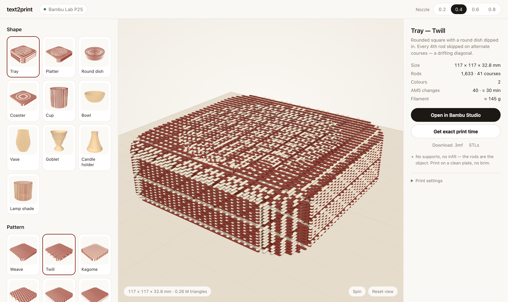
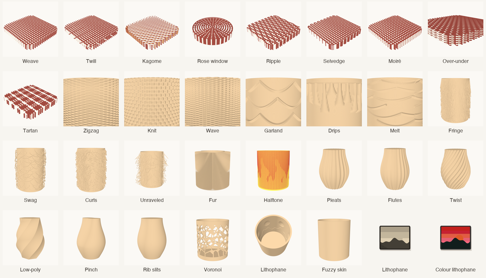

<h1 align="center">text2print</h1>

<p align="center"><em>Pick a shape. Pick a texture. Print it on your Bambu.</em></p>

<p align="center">
  <a href="LICENSE"></a>
  
  
</p>

<p align="center"></p>

text2print makes textured objects for 3D printing. Every texture is a construction, not a surface effect:
woven rods stacked course by course into open basketry, or printed fabric whose layers zigzag in mid-air.
You pick a shape, a texture, sizes, colours and a nozzle; it builds the object live and hands you a
Bambu Studio project with the right settings already in it.

## Run it

```bash
python3.12 -m venv .venv && .venv/bin/pip install -r requirements.txt
.venv/bin/python -m text2print studio            # opens http://127.0.0.1:7384
```

Pick, watch it rebuild (a quick sketch while you drag, the full build when you let go), then **Open in
Bambu Studio**. The project lands in `~/Downloads/text2print/`:
one object, one part per colour already mapped to AMS slots, the P2S profile for your nozzle, no supports.
**Get exact print time** slices it with the Bambu Studio CLI in the background — real AMS changes and purge
included — and remembers the result for that design. **Save design** keeps it (with a thumbnail and the
slicer's numbers) under **Saved**; every design is also a shareable link.

Everything else lives in the studio too:

- **Up to 4 colours.** Any fabric or droop piece (and woven pieces coloured by height) splits into 1–4 colour
  bands or repeating stripes, cut exactly on layer boundaries. Mixes give each band its own AMS slot.
- **Lids.** Cups, vases, bowls, dishes, trays, baskets, catch-alls and platters can get a lid, set up in its own
**Lid** section. By default the lid gets the piece's own treatment: a short cap of the same shape, texture and
colours, printed top-face down, whose rim lands on the piece's rim so the texture carries across. Or pick any look
for it (plain, any woven, fabric, halftone, vase-mode or Voronoi texture) in its own AMS colours, set its height,
and choose a knob, a flat button or none. Inside the cap sits the closure: slip-on, a two-start screw (half a turn
closes it) or six 6 × 2 mm magnets on a pedestal, all on round rims; square and hex pieces take slip lids that
follow their opening. Pick a fit (snug 0.15, slip 0.25 or loose 0.40 mm a side); the *Fit* test plate prints
rings and lids at each clearance. Droop isn't offered for lids: strands would point up once the lid is flipped
on. On woven lids the hidden plug changes colour course by course with the rods; the change count covers
everything on the plate.

From the command line:

```bash
python -m text2print list                                     # shapes, textures, what fits what
python -m text2print make tray twill --set width=117 --colours "#8B3A2F,#EDE3D1" --out ~/Downloads/tray --slice
python -m text2print make vase wave --set height=200 --nozzle 0.6 --out ~/Downloads/vase
python -m text2print make cup halftone --nozzle 0.8 --image flames.png --colours "#F3D34A,#C3302C" --out ~/Downloads/flames
```

## Textures

<p align="center"></p>

**Woven rods.** Each course is a row of parallel rounded beads; the next course runs another way, so every
rod bridges a short gap across the ones below. No supports, no infill, no walls — the rods are the object.
Colour follows direction, so the AMS changes once per course (Over-under and Tartan mix colours inside a
course and change about once per layer).

| Texture | What it is |
|---|---|
| Weave | Rods cross at right angles; the classic |
| Twill | Every 4th rod skipped on alternate courses: a drifting diagonal (the print-verified tray) |
| Kagome | Three directions at 60°: triangles and hexagons, up to three colours |
| Rose window | Rings and spokes that halve toward the centre (round shapes) |
| Ripple | Wavy rods against straight ones: reed and honeycomb |
| Selvedge | Rod ends join in loops: a woven hem on every edge, including the dish |
| Moiré | Two rod spacings that beat into large bands |
| Over-under | A true weave: rods pass over and under each other |
| Tartan | Colour runs along both directions: plaid |

**Printed fabric.** A two-loop wall whose layers alternate between mid-air stitches and straight rings.

| Texture | What it is |
|---|---|
| Zigzag | Crisscrossing fins that open into diamonds |
| Knit | Rounded stitch domes in offset rows |
| Wave | Mirrored sine strands with eye-shaped windows |

Fabric pieces can add a looped rim and diamond or eye cut-outs in the floor.

**Reliefs.** Raised textures on a fabric-thin wall, every underside ramped at 45° or less so they print without
supports: **Garland** (festoon scallops), **Drips** (a glue-gun bead with drips running down), **Melt** (sagging
coil beads with broken arcs).

**Droop.** Single strands leave the wall, arc into air, and sag under gravity into hanging loops. The
printer lays each span fast and hot so it stays molten and falls; the preview shows it after the droop,
with an "As printed" switch for the flat strands the printer actually lays.

| Texture | What it is |
|---|---|
| Fringe | Dense narrow loops that fall into a long hanging fringe |
| Swag | Wide, fat loops that sag into layered festoons |
| Curls | Small loops in drifting columns that settle into coils |
| Unraveled | A wild mix of short and long loops, as if the wall is coming apart |

Droop pieces choose a density and a loop length. With 2–4 colours they default to **Courses**, the woven idea
applied to strands: each row of loops and the wall it hangs from take the next colour, so the colours stripe up the
piece like rod courses and the AMS changes once per course. Colour boundaries only fall between rows, never through
a strand, and the hung preview keeps every strand in its row's colour. *Rows per colour* (1–4) widens the stripes
and divides the changes. Bands and Stripes are still there.

**Halftone.** Two colours alternate every print layer, each layer one wide wavy line. Where the picture wants
colour 1, its layers rib outward and colour 2's stay flat behind them, and the reverse elsewhere; the rib depth
is the grey level. Built-in pictures: flames, fade, polka dots, chevron, waves, or your own image from the
command line (`--image photo.png`). It prints at the nozzle's maximum layer height with one wide line
(0.8 nozzle: 0.56 mm layers, 1.4 mm line; 0.4: 0.28 / 1.0), the recipe from kowafatcompany's
[Fire Flame Vase](https://makerworld.com/en/models/3429731). The AMS changes every layer, so a 0.8 nozzle or
"2 or 3 layers per colour" keeps the change count sane. Three more levers cut changes and purge: keep the
picture to the bottom half or third, flush purge into the infill of a solid coaster on the plate, or print with
one dual-colour silk spool and let the ribs turn the sheen (no changes at all). Works on cup, vase, bowl and goblet; the rib depth shrinks
where a wall flares so a rib never overhangs more than 60 % of its line.

**Vase mode.** One continuous wall printed in Bambu's spiral vase mode: no seams, no colour changes, and
fast. **Pleats** (sharp folds), **Flutes** (rounded channels), **Twist** (folds that turn up the wall),
**Low-poly** (faceted, turning), **Pinch** (soft lobes pinched at the waist) and **Slit ribs** (fins on a solid
body, cut by hairline slits so vase mode traces every fin). Dual- or tri-colour silk shows the folds best. Spiral
mode can't change filament, so these are one colour.

**Shell.** Plain-wall textures. **Voronoi** cuts organic cells through the wall, gable-roofed so every hole
prints without supports. **Lithophane** carves a picture into a thick wall that shows when lit from inside.
**Fuzzy skin** paints Bambu's fuzzy skin onto chosen bands (orange peel, billow, marble or stone noise); it
appears in the sliced preview.

**Flat.** Pictures on a tile that print face-down and show backlit. **Lithophane** is one white filament whose
thickness is the grey level. **CMYK** stacks cyan, magenta and yellow under a white body; the ink depth per pixel
mixes the colour, and each layer starts with the colour already loaded (13 changes on a test tile).

**Fur.** Short single-line hairs bridge off the wall at full fan and a little cooler, so they stay stiff and
stand out like a pelt.

**Mix.** Stack textures in bands up one wall: plain, zigzag, knit, wave, halftone, fringe, swag, curls and
unraveled, each band with its own height and AMS colour. Presets: *Coil band* (plain, curls, plain), *Fringe
skirt* (wave foot, dense fringe, plain neck), *Flame foot* (halftone flames under zigzag) and *Knit & wave*.
Bands print at the nozzle's standard layer height, except halftone bands, which keep their 0.28 mm (0.4
nozzle) recipe through a Bambu layer range. The AMS changes where two colours meet (and every layer inside a
halftone band). A fuzzy band paints fuzzy skin onto its stretch of wall. Droop bands get their own low-fan, +5 °C filament settings; give a droop band its own colour slot
and the rest of the piece keeps full cooling. Woven bands join a mix too: Weave, Twill, Ripple, Moiré and Rose window. A woven band is a ring of rods centred
on the wall, one colour per rod direction (one AMS change per course). It starts on a solid collar that widens
from the thin wall below at 45°, or on a solid floor if it is the bottom band, and ends on a cap that narrows back
to the wall for the band above. Its layers print with four wall loops and woven bridge speeds. Preset: *Basket
band* (plain foot, twill middle, plain neck). Kagome, Over-under and Tartan stay whole-piece only: they need a
third colour or mix colours inside a course. Mixes work on cup, vase, bowl and goblet.

```bash
# mixes are easiest in the studio; every mix is a shareable link (/?shape=vase&texture=mix&mix=[...])
```

## Shapes

| Shape | Textures | Sizes |
|---|---|---|
| Tray | woven, fabric, droop, halftone, mix, vase mode, shell | width, height, dish, floor, corner, top edge |
| Platter | woven, fabric, droop, halftone, mix, vase mode, shell | the low, wide tray |
| Round dish | woven (incl. Rose window), fabric, droop, halftone, mix, vase mode, shell | diameter, height, dish, floor, top edge |
| Coaster | woven, fabric, halftone, shell | width, height, seat, floor, corner |
| Cup | woven, fabric, droop or halftone | diameter, height (+ wall and floor for rods) |
| Lamp shade | woven | open cylinder: diameter, height, wall |
| Bowl | woven, fabric, droop or halftone | diameter, height, base width |
| Vase | woven, fabric, droop or halftone | belly, height, neck |
| Goblet | woven, fabric, droop or halftone | a cup on a stem and foot |
| Candle holder | droop | a solid bell with a socket for a taper candle |
| Your shape | woven, fabric, droop, halftone, mix, vase mode, shell | widest, height, and a 5-point drawn silhouette |
| Cachepot | woven, fabric, halftone, vase mode, shell | sized to a 3–7 in nursery pot, with a foot ring that lifts it |
| Liner sleeve | woven, fabric, vase mode, shell | slides over a glass liner (a cylinder vase or jar) |
| Tealight lantern | fabric, shell, halftone | plinth with a 41 × 17 mm tealight pocket |
| Pendant shade | fabric, droop, shell | top plate with a 40 mm hole for an E27 socket ring |
| Puck lamp | fabric, shell, halftone | collar pocket for a 59 × 18 mm LED puck, with a cable notch |
| Amphora | woven, fabric, vase mode, shell | tall belly and neck that never lean past 45° |
| Basket | woven, fabric, droop, halftone, mix, vase mode, shell | rounded box with two arched handle holes |
| Catch-all | woven, fabric, droop, halftone, mix, vase mode, shell | low rounded tray |
| Hex tile | woven, flat, fabric, halftone, shell | hexagon: lattice tile or backlit picture |
| Tile | flat | rounded rectangle for lithophanes and CMYK |

**Woven vessels.** Woven rods work on every round silhouette, not just the cup: bowl, vase, goblet, your drawn
shape, cachepot, glass sleeve and amphora. The rod ring follows the silhouette course by course, and no course
steps more than 0.8 mm per mm (about 39°) in or out of the one below, because rod ends overhang on both faces.
Cachepot and sleeve keep their fitted inner size and the weave grows outward. A woven 180 mm vase slices at about
14 h 40 min and 260 g in two colours. Rose window turns into stacked hoops on curved walls, because its rings
sit at fixed radii.

**Square, rectangular and hex pieces.** The wall textures work on the tray, platter, coaster, basket, catch-all
and hex tile too. They build a round piece with the same circumference as the outline, then map it on: distance
around the circle becomes distance along the outline, and every offset from the wall follows the outline's
normal. Stitch spacing and wall thickness come out the same as on a round piece. Basket handle slots are cut
through any wall texture except vase mode, which can't print a hole in its single wall. Square, rectangular and textured pieces get a
slip lid whose plug follows the real opening: the app slices the piece just under the rim to find it. Dish, floor, top edge and wall sizes stay woven-only.

**Fittings.** The lamp, lantern, pendant, cachepot and candle shapes carry their hardware fit. The collar,
plinth, foot ring or crush ribs print in the floor colour, and the app adds the safety copy: LED pucks and
tealights in LED form only for shades, and a taper bore of 23 mm with six crush ribs.

**Lids.** Cups, vases, bowls, dishes and trays can get a lid: slip-on, a two-start screw (half a turn closes it),
or six 6 × 2 mm magnets. Pick a fit (snug 0.15, slip 0.25 or loose 0.40 mm a side); the *Fit* test plate prints
rings and lids at each clearance so you can choose before printing the piece.

## Made for the Bambu Lab P2S

| Nozzle | Layer | Rod bead | Rod spacing | |
|---|---|---|---|---|
| 0.2 mm | 0.10 mm | 0.88 × 0.40 mm | 1.88 mm | computed |
| **0.4 mm** | **0.20 mm** | **1.68 × 0.80 mm** | **3.60 mm** | **print-verified** |
| 0.6 mm | 0.30 mm | 1.86 × 1.20 mm | 4.06 mm | computed |
| 0.8 mm | 0.40 mm | 2.46 × 1.60 mm | 5.26 mm | computed |

The P2S settings in `text2print/data/` are Bambu's own presets (machine, process and PLA Matte for each
nozzle) with every `inherits` link resolved, so projects don't depend on your Bambu Studio install.
`data/build_profiles.py` regenerates them. Each texture family then sets what it needs: rods print as
4 side-by-side loops with bridges and overhangs at full speed (the slicer calls every span an overhang;
at its stock 10 mm/s the print takes twice as long for nothing); fabric prints as a 2-loop shell with
0% infill and no top layers. Objects are capped at 200 mm so the prime tower always fits back-right.

## What the slicer confirmed

- Bambu Studio's CLI honours each part's AMS slot once every per-filament setting list is the right length, so
  the exact-time numbers include real colour changes. On three mixes the slicer's change count matched the app's
  estimate exactly.
- Layer ranges are keyed by the object's position in the build (`Metadata/layer_config_ranges.xml`). A range
  must set `layer_height`; line widths in a range drop layers of multi-part objects, and "extruder" breaks them.
- The prime tower needs every object on a plate to share one set of layer ranges.
- Weight comes back one number per filament; the app sums them.
- Spiral vase mode prints one wall and can't change filament.
- With three or more colours the prime tower grows deep: it parks front-right with 20 mm margins, or the G-code
  leaves the printable area.
- Purge per change comes from the colour pair (light after dark costs most), not a flat number.

## Laws

These are print-verified, and the tests enforce the geometric ones.

- A woven object has a flat, full-size first course, and no course reaches past the one below it.
- A rod's skin stays inside the outline: bead centre lines are clipped half a bead in.
- Each colour is a part of one object, never its own object (alternating courses leave empty layers, which Bambu refuses).
- Fabric stitches keep their swing-to-wavelength ratio at every height, so narrow necks don't collapse.
- The layer height is part of the geometry: print at the nozzle's layer height.
- Droop strands are one extrusion wide, at most 4 layers tall, never touch each other in the mesh, and start high
  enough that the droop can't reach the bed. They print with overhang slow-down off, fan at 20 % and the nozzle
  5 °C hotter; slow or cold strands freeze where they are laid.

## Repo

```
text2print/   shapes.py · lattice.py (woven rods) · droop.py (strands, fur) · halftone.py · compose.py (mix) · extras.py (zones, lids)
              spiral.py (vase mode) · shell.py (voronoi, litho, fuzzy) · flat.py (tiles) · fittings.py · meshops.py
              sampler.py (test plates) · verify.py · store.py (~/.text2print) · lan.py (send) · fabric.py + fabric_wall.py + fabric_presets.py (fabric)
              floors.py · build.py (pick -> project) · printer.py + data/ (P2S) · bambu.py (3MF + CLI slice)
studio/       server.py + static/ (the picker)
tests/        python -m pytest          (fast)   ·   python -m pytest -m ""   (everything, incl. the real slicer)
```

Adding a texture is one function in `lattice.py` (`PATTERNS`) or `fabric.py` (`STITCHES`); adding a shape is
one entry in `shapes.py`. Run `python -m text2print thumbs` to render its card.
