<h1 align="center">text2print</h1>

<p align="center"><strong>Textured, multicolour 3D prints for Bambu Lab, generated from a shape and a texture.</strong></p>

<p align="center">
  <a href="LICENSE"></a>
  
  
  
  
  
  
  <a href="https://github.com/stilwellc/text2print/stargazers"></a>
</p>

<p align="center">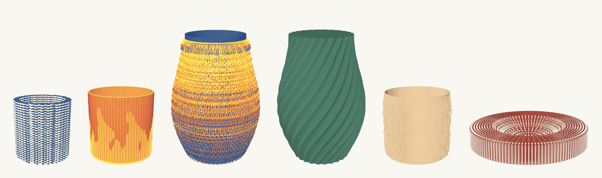</p>

<p align="center">
Woven baskets, knit and loop vases, halftone pictures, vase-mode twists, droop fringe and lithophanes.<br>
Pick a shape and a texture, and get a <b>print-ready Bambu Studio 3MF</b> with the AMS colours already mapped.
</p>

<p align="center">
  <a href="#quick-start"><b>Quick start</b></a> ·
  <a href="#textures"><b>All 43 textures</b></a> ·
  <a href="#use-it-as-a-claude-code-skill"><b>Claude Code skill</b></a> ·
  <a href="#faq"><b>FAQ</b></a>
</p>

## Quick start

```bash
git clone https://github.com/stilwellc/text2print && cd text2print
python3.12 -m venv .venv && .venv/bin/pip install -r requirements.txt
.venv/bin/python -m text2print studio        # opens the studio at http://127.0.0.1:7384
```

Or skip the studio and make one from the command line:

```bash
./t2p make dish polar --colours "#2E4E7E,#EDE3D1" --out ~/Downloads/dish --preview --slice
```

<p align="center">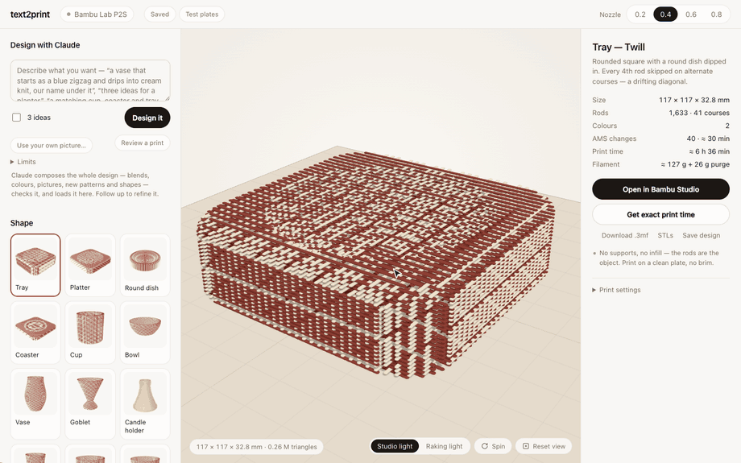</p>
<p align="center"><sub>The studio: pick a shape, a pattern and colours; the preview rebuilds live and the print card shows time, filament and AMS changes.</sub></p>

## Why text2print

Every texture is a **construction, not a surface effect**: woven rods stacked course by course into open
basketry, printed fabric whose layers zigzag in mid-air, colour-knit walls hung with thousands of single-strand
loops. text2print builds that geometry directly, so what you see in the preview is what the printer lays down.

- **43 textures, 25 shapes.** Weaves, twills, kagome, knit, zigzag, fringe, fur, halftone, CMYK, voronoi,
  lithophane, fuzzy skin and spiral vase mode, on cups, vases, bowls, trays, baskets, lamp shades, lidded boxes and more.
- **Multicolour without the pain.** Colour plans are laid out to keep AMS filament changes and purge low, and
  every texture card shows its colour-change cost before you pick it.
- **Print-ready, checked in the slicer.** Bambu's own P2S presets are built in, with no supports needed;
  *Get exact print time* slices with the Bambu Studio CLI for the real time, grams and colour changes.
- **Lids, fittings and text.** Slip, screw or magnet lids; LED puck and tealight fittings; words debossed under
  the base or inlaid in a second colour.
- **Extendable by prompt.** Describe "a koi pond halftone" or "a fish-scale knit" and Claude writes a plugin
  for it, checks the build and hands it back selected in the studio.

## How it works

<p align="center">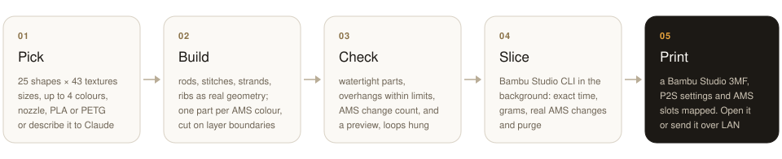</p>

<table>
  <tr>
    <td align="center" width="50%">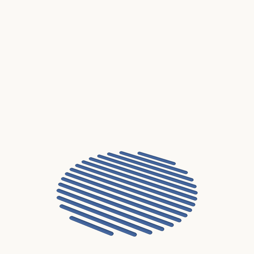<br><sub><b>Woven rods, course by course.</b> Each course is a row of rods that bridges the gaps in the one below it. Colour follows direction, so the AMS changes once per course.</sub></td>
    <td align="center" width="50%">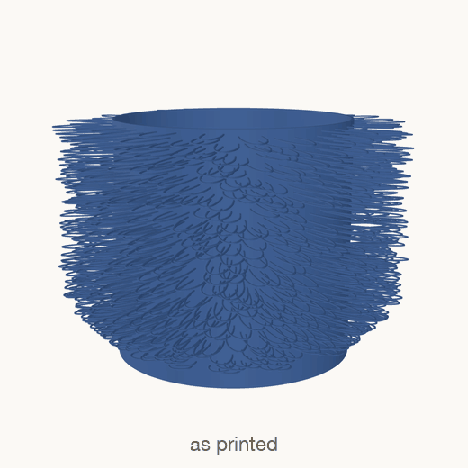<br><sub><b>Droop, as printed and after.</b> Strands are laid flat into the air, fast and hot, then sag into a hanging fringe as they cool. The preview shows both.</sub></td>
  </tr>
</table>

## Made with text2print

<table align="center">
  <tr>
    <td align="center">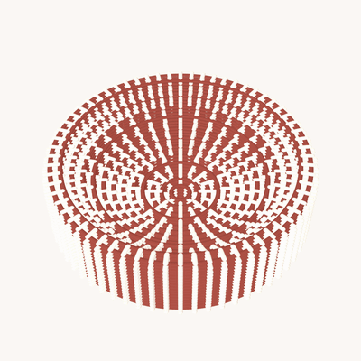<br><sub><b>Woven rods</b> · rose window</sub></td>
    <td align="center">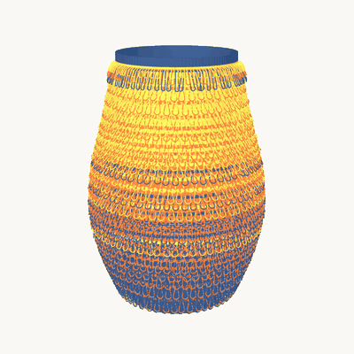<br><sub><b>Loops on colour-knit</b> · teardrop tiers</sub></td>
    <td align="center">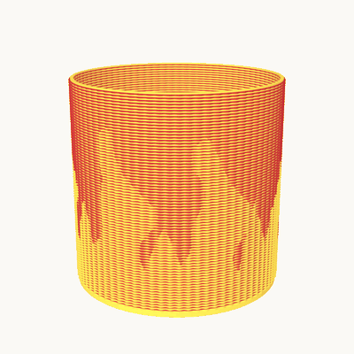<br><sub><b>Halftone</b> · flames</sub></td>
  </tr>
  <tr>
    <td align="center">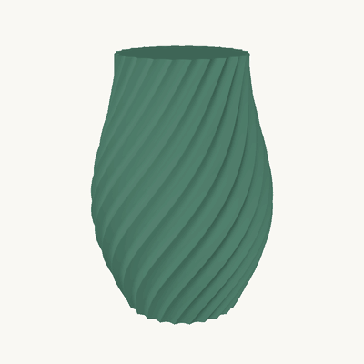<br><sub><b>Vase mode</b> · twist</sub></td>
    <td align="center">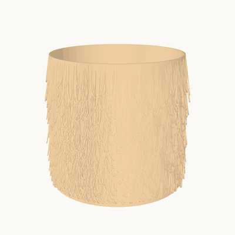<br><sub><b>Droop</b> · fringe</sub></td>
    <td align="center">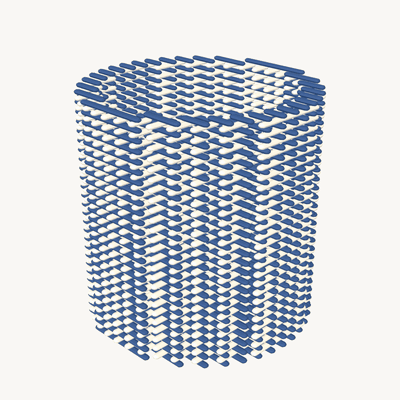<br><sub><b>Woven rods</b> · grid cup</sub></td>
  </tr>
</table>

<p align="center"><sub>Every animation here is the real build: the same geometry that goes into the Bambu Studio project, rendered by
<a href="docs/make_media.py"><code>docs/make_media.py</code></a>, <a href="docs/make_motion.py"><code>make_motion.py</code></a> and <a href="docs/make_hero.py"><code>make_hero.py</code></a>.</sub></p>

**Contents:** [Run it](#run-it) · [Command line](#without-the-studio) · [Claude Code skill](#use-it-as-a-claude-code-skill) ·
[Textures](#textures) · [Loops](#loops-on-colour-knit) · [Plugins](#custom-pictures-and-patterns) · [Shapes](#shapes) ·
[P2S settings](#made-for-the-bambu-lab-p2s) · [FAQ](#faq) · [Repo](#repo)

## Run it

```bash
python3.12 -m venv .venv && .venv/bin/pip install -r requirements.txt
.venv/bin/python -m text2print studio            # opens http://127.0.0.1:7384
```

Pick, watch it rebuild (a quick sketch while you drag, the full build when you let go), then **Open in
Bambu Studio**. The project lands in `~/Downloads/text2print/`:
one object, one part per colour already mapped to AMS slots, the P2S profile for your nozzle, no supports.
**Get exact print time** slices it with the Bambu Studio CLI in the background — real AMS changes and purge
included — and remembers the result for that design. **Save design** keeps it (with a thumbnail and the
slicer's numbers) under **Saved**; every design is also a shareable link.

Everything else lives in the studio too:

- **Up to 4 colours.** Any fabric or droop piece (and woven pieces coloured by height) splits into 1–4 colour
  bands or repeating stripes, cut exactly on layer boundaries. Mixes give each band its own AMS slot.
- **PLA or PETG.** Every texture has a *Filament* switch. PETG takes Bambu's own Generic PETG preset for the P2S,
  per colour, with the bed held at 60 °C.
- **Lids.** Cups, vases, bowls, dishes, trays, baskets, catch-alls and platters can get a lid, set up in its own
**Lid** section. By default the lid gets the piece's own treatment: a short cap of the same shape, texture and
colours, printed top-face down, whose rim lands on the piece's rim so the texture carries across. Or pick any look
for it (plain, any woven, fabric, halftone, vase-mode or Voronoi texture) in its own AMS colours, set its height,
and choose a knob, a flat button or none. Inside the cap sits the closure: slip-on, a two-start screw (half a turn
closes it) or six 6 × 2 mm magnets on a pedestal, all on round rims; square and hex pieces take slip lids that
follow their opening. Pick a fit (snug 0.15, slip 0.25 or loose 0.40 mm a side); the *Fit* test plate prints
rings and lids at each clearance. Droop isn't offered for lids: strands would point up once the lid is flipped
on. On woven lids the hidden plug changes colour course by course with the rods; the change count covers
everything on the plate.

## Without the studio

Everything the studio does is also a command. `./t2p` runs from any folder (it is `python -m text2print` with the
path set). Commands print JSON; a bad request exits 2 with an `error` that says what to fix.

```bash
./t2p list                                # shapes, their sizes, the textures that fit each
./t2p options jacquard                    # every option a texture takes, its choices and default
./t2p make tray twill --set width=117 --colours "#8B3A2F,#EDE3D1" --out ~/Downloads/tray --preview --slice
./t2p make vase wave --set height=200 --nozzle 0.6 --out ~/Downloads/vase
./t2p make cup halftone --nozzle 0.8 --image flames.png --colours "#F3D34A,#C3302C" --out ~/Downloads/flames
./t2p make vase jacquard --option loops=tiers --option band=2 --colours "#2E4E7E,#E8752F,#F3D34A" --out ~/Downloads/tiers
```

A design is one JSON object, and `make --design` takes it as a file, from stdin (`-`), as a studio link, or as the
name of a saved design:

```json
{"shape": "cup", "texture": "jacquard", "nozzle": 0.4,
 "params": {"diameter": 90, "height": 110},
 "colours": ["#151515", "#F4F2EC"],
 "options": {"loops": "shag", "band": 2, "stitch_size": "fine"}}
```

```bash
./t2p make --design cup.json --draft --preview --out /tmp/look     # a quick sketch and a picture of it
./t2p make --design cup.json --preview --slice --save "Shag cup" --open --out ~/Downloads/shag-cup
./t2p link cup.json                       # the same design as a studio link; give it a link to get the JSON back
./t2p designs list                        # the studio's Saved list: show, save, delete, or build one by name
./t2p printer test                        # LAN connection check; `send DESIGN --confirm` slices and starts a print
./t2p ask "a low bowl that fades from brick to bone, our name under it" --ideas 3      # Design with Claude
./t2p taste like cup.json --note "more of this"
```

| `make` flag | |
|---|---|
| `--set key=mm`, `--option key=value`, `--colours`, `--nozzle` | sizes, options, colours and nozzle; they also adjust a loaded design. A value that is JSON is read as JSON, so mixes (`bands=[...]`) and charts (`chart=[...]`) fit on the command line |
| `--draft` | quick sketch build for looking, never for printing |
| `--preview` | a PNG with loops and strands hung as they will fall, and the lid on |
| `--slice` | run Bambu Studio's CLI for the real time, grams and layers |
| `--save NAME`, `--open`, `--no-stls`, `--name STEM` | add to Saved, open in Bambu Studio, skip the STLs, name the files |

The output carries the project path, the design as built, a studio link to it, the stats (size, AMS changes,
grams), the warnings and whether every part is watertight. `./t2p catalogue` prints everything a design can use as
JSON (mix bands, chart bands, lids, pictures, the palette), which is what an agent reads first. `SKILL.md` is the
same workflow written as a Claude Code skill; link the repo into `~/.claude/skills/text2print` to install it.

## Use it as a Claude Code skill

text2print ships as a [Claude Code](https://claude.com/claude-code) skill (`SKILL.md`). Link the repo into your
skills folder and ask for a print in plain words:

```bash
ln -s "$PWD" ~/.claude/skills/text2print
```

> *"A low woven bowl that fades from brick to bone, our name under the base."*

Claude reads the catalogue, composes the design, builds it, looks at the preview and hands you the Bambu
project. When nothing in the catalogue fits, it writes a new weave, stitch, picture or shape as a plugin and
checks it first. The studio's **Design with Claude** box does the same thing from the browser.

## Textures

<table>
  <tr><td colspan="6"><b>Woven rods</b> · 17</td></tr>
  <tr>
    <td align="center" width="16%">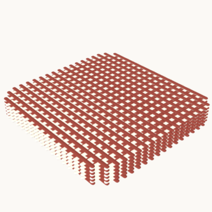<br><sub>Weave</sub></td>
    <td align="center" width="16%"><br><sub>Twill</sub></td>
    <td align="center" width="16%">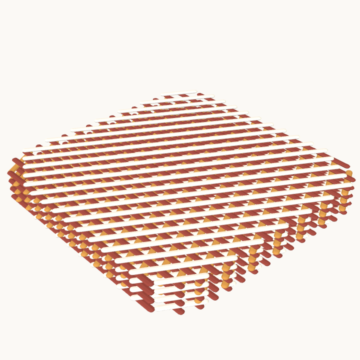<br><sub>Kagome</sub></td>
    <td align="center" width="16%">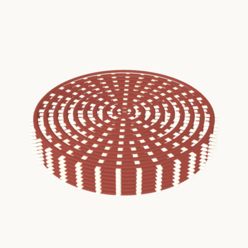<br><sub>Rose window</sub></td>
    <td align="center" width="16%">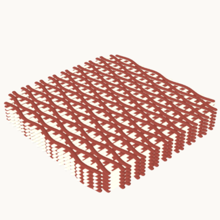<br><sub>Ripple</sub></td>
    <td align="center" width="16%">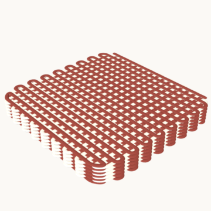<br><sub>Selvedge</sub></td>
  </tr>
  <tr>
    <td align="center" width="16%">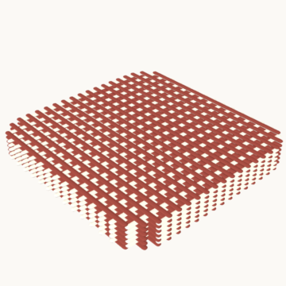<br><sub>Moiré</sub></td>
    <td align="center" width="16%">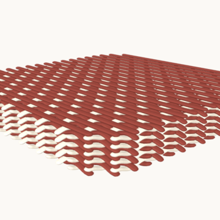<br><sub>Over-under</sub></td>
    <td align="center" width="16%">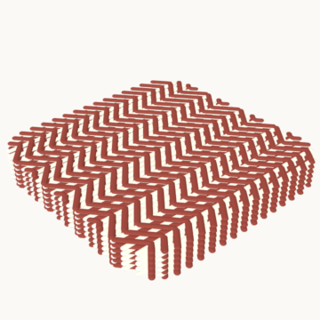<br><sub>Chevron</sub></td>
    <td align="center" width="16%">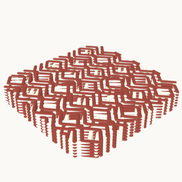<br><sub>Herringbone</sub></td>
    <td align="center" width="16%">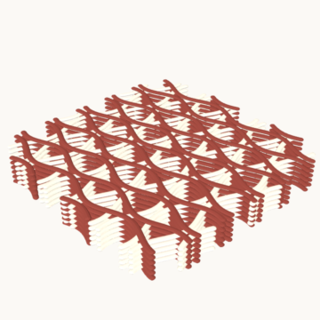<br><sub>Ogee</sub></td>
    <td align="center" width="16%">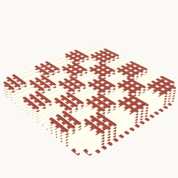<br><sub>Basketweave</sub></td>
  </tr>
  <tr>
    <td align="center" width="16%">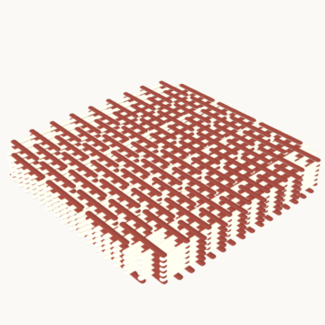<br><sub>Brick bond</sub></td>
    <td align="center" width="16%">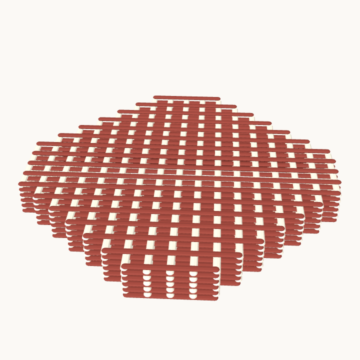<br><sub>Trellis</sub></td>
    <td align="center" width="16%">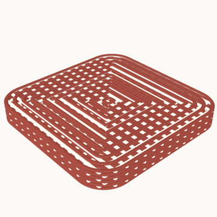<br><sub>Picture frame</sub></td>
    <td align="center" width="16%">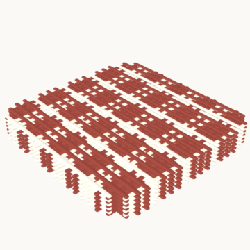<br><sub>Tartan</sub></td>
    <td align="center" width="16%">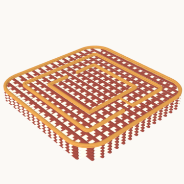<br><sub>Labyrinth</sub></td>
  </tr>
  <tr><td colspan="6"><b>Printed fabric and reliefs</b> · 6</td></tr>
  <tr>
    <td align="center" width="16%">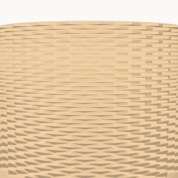<br><sub>Zigzag</sub></td>
    <td align="center" width="16%">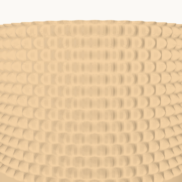<br><sub>Knit</sub></td>
    <td align="center" width="16%">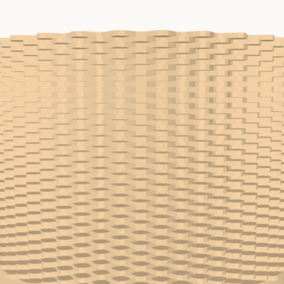<br><sub>Wave</sub></td>
    <td align="center" width="16%">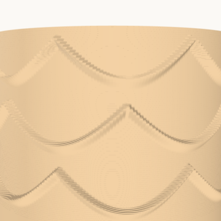<br><sub>Garland</sub></td>
    <td align="center" width="16%">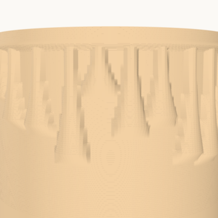<br><sub>Drips</sub></td>
    <td align="center" width="16%">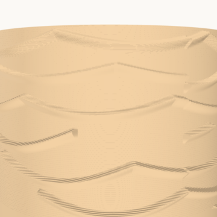<br><sub>Melt</sub></td>
  </tr>
  <tr><td colspan="6"><b>Droop and fur</b> · 5</td></tr>
  <tr>
    <td align="center" width="16%">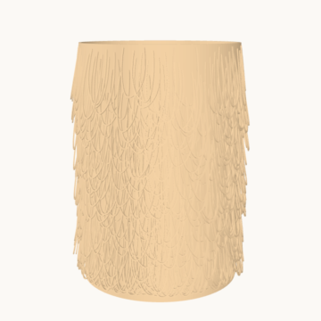<br><sub>Fringe</sub></td>
    <td align="center" width="16%">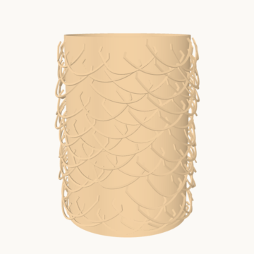<br><sub>Swag</sub></td>
    <td align="center" width="16%">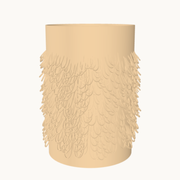<br><sub>Curls</sub></td>
    <td align="center" width="16%">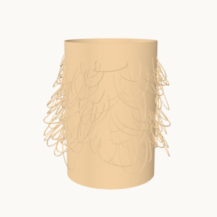<br><sub>Unraveled</sub></td>
    <td align="center" width="16%">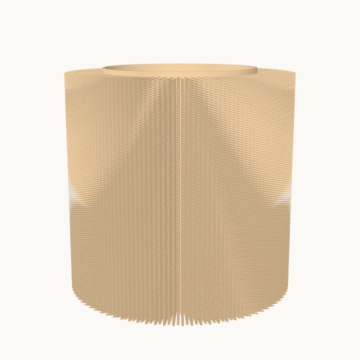<br><sub>Fur</sub></td>
  </tr>
  <tr><td colspan="6"><b>Colour pictures and knit</b> · 3</td></tr>
  <tr>
    <td align="center" width="16%">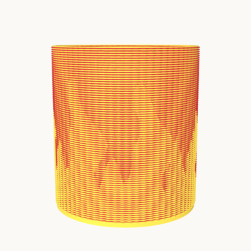<br><sub>Halftone</sub></td>
    <td align="center" width="16%">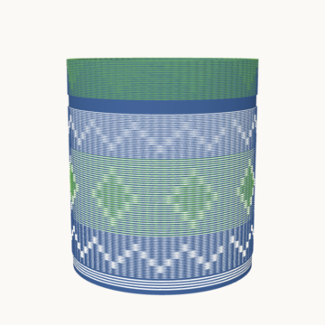<br><sub>Jacquard</sub></td>
    <td align="center" width="16%">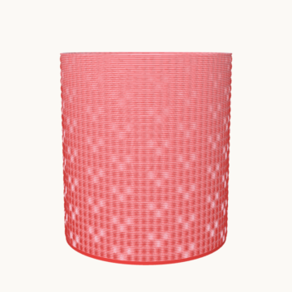<br><sub>Bead knit</sub></td>
  </tr>
  <tr><td colspan="6"><b>Vase mode</b> · 6</td></tr>
  <tr>
    <td align="center" width="16%">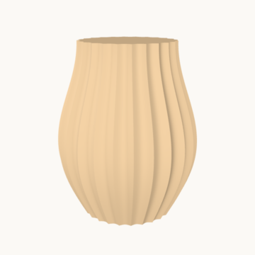<br><sub>Pleats</sub></td>
    <td align="center" width="16%">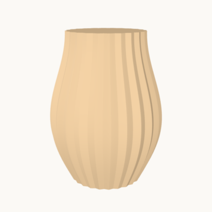<br><sub>Flutes</sub></td>
    <td align="center" width="16%">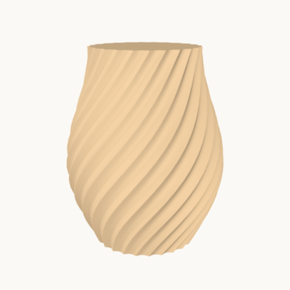<br><sub>Twist</sub></td>
    <td align="center" width="16%">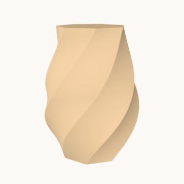<br><sub>Low-poly</sub></td>
    <td align="center" width="16%">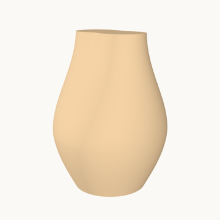<br><sub>Pinch</sub></td>
    <td align="center" width="16%">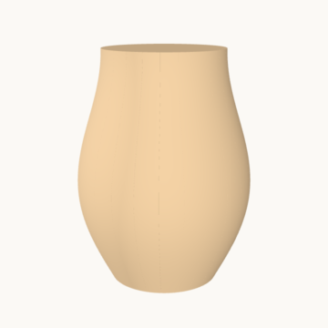<br><sub>Rib slits</sub></td>
  </tr>
  <tr><td colspan="6"><b>Shell</b> · 3</td></tr>
  <tr>
    <td align="center" width="16%">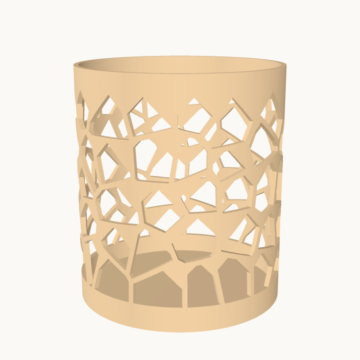<br><sub>Voronoi</sub></td>
    <td align="center" width="16%">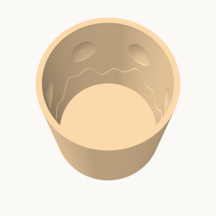<br><sub>Lithophane</sub></td>
    <td align="center" width="16%">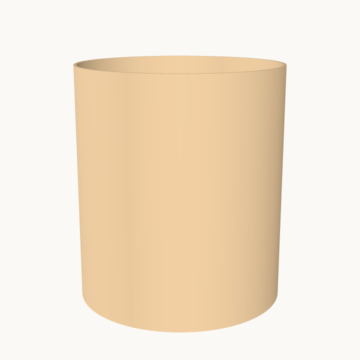<br><sub>Fuzzy skin</sub></td>
  </tr>
  <tr><td colspan="6"><b>Flat tiles</b> · 2</td></tr>
  <tr>
    <td align="center" width="16%"><br><sub>Lithophane</sub></td>
    <td align="center" width="16%"><br><sub>Colour lithophane</sub></td>
  </tr>
  <tr><td colspan="6"><b>Mix</b> · 1</td></tr>
  <tr>
    <td align="center" width="16%"><br><sub>Mix</sub></td>
  </tr>
</table>

<sub>Every card is rendered by the studio itself (`python -m text2print thumbs`).</sub>

**Woven rods.** Each course is a row of parallel rounded beads; the next course runs another way, so every
rod bridges a short gap across the ones below. No supports, no infill, no walls — the rods are the object.
Colour follows direction, so the AMS changes once per course (Over-under and Tartan mix colours inside a
course and change about once per layer).

| Texture | What it is |
|---|---|
| Weave | Rods cross at right angles; the classic |
| Twill | Every 4th rod skipped on alternate courses: a drifting diagonal (the print-verified tray) |
| Kagome | Three directions at 60°: triangles and hexagons, up to three colours |
| Rose window | Rings and spokes that halve toward the centre (round shapes) |
| Ripple | Wavy rods against straight ones: reed and honeycomb |
| Selvedge | Rod ends join in loops: a woven hem on every edge, including the dish |
| Moiré | Two rod spacings that beat into large bands |
| Over-under | A true weave: rods pass over and under each other |
| Tartan | Colour runs along both directions: plaid |
| Chevron | Parallel zigzag rods crossed by straight ones: stacked Vs |
| Herringbone | Zigzag rods both ways, flipping in blocks: woven tweed |
| Ogee | Wavy rods mirrored in pairs, pinching into onion-shaped lenses |
| Basketweave | Checkerboard blocks where one direction drops away to show the other |
| Brick bond | Rods broken into staggered bricks over a full cross course |
| Trellis | Rods at ±45°: an open diamond trellis |
| Picture frame | Rods follow the piece's own outline in concentric rings, on any shape |

**Printed fabric.** A two-loop wall whose layers alternate between mid-air stitches and straight rings.

| Texture | What it is |
|---|---|
| Zigzag | Crisscrossing fins that open into diamonds |
| Knit | Rounded stitch domes in offset rows |
| Wave | Mirrored sine strands with eye-shaped windows |

Fabric pieces can add a looped rim and diamond or eye cut-outs in the floor.

**Reliefs.** Raised textures on a fabric-thin wall, every underside ramped at 45° or less so they print without
supports: **Garland** (festoon scallops), **Drips** (a glue-gun bead with drips running down), **Melt** (sagging
coil beads with broken arcs).

**Droop.** Single strands leave the wall, arc into air, and sag under gravity into hanging loops. The
printer lays each span fast and hot so it stays molten and falls; the preview shows it after the droop,
with an "As printed" switch for the flat strands the printer actually lays.

| Texture | What it is |
|---|---|
| Fringe | Dense narrow loops that fall into a long hanging fringe |
| Swag | Wide, fat loops that sag into layered festoons |
| Curls | Small loops in drifting columns that settle into coils |
| Unraveled | A wild mix of short and long loops, as if the wall is coming apart |

Droop pieces choose a density and a loop length. With 2–4 colours they default to **Courses**, the woven idea
applied to strands: each row of loops and the wall it hangs from take the next colour, so the colours stripe up the
piece like rod courses and the AMS changes once per course. Colour boundaries only fall between rows, never through
a strand, and the hung preview keeps every strand in its row's colour. *Rows per colour* (1–4) widens the stripes
and divides the changes. Bands and Stripes are still there.

**Halftone.** Two colours alternate every print layer, each layer one wide wavy line. Where the picture wants
colour 1, its layers rib outward and colour 2's stay flat behind them, and the reverse elsewhere; the rib depth
is the grey level. Built-in pictures: flames, fade, polka dots, chevron, waves, or your own image from the
command line (`--image photo.png`). It prints at the nozzle's maximum layer height with one wide line
(0.8 nozzle: 0.56 mm layers, 1.4 mm line; 0.4: 0.28 / 1.0), the recipe from kowafatcompany's
[Fire Flame Vase](https://makerworld.com/en/models/3429731). The AMS changes every layer, so a 0.8 nozzle or
"2 or 3 layers per colour" keeps the change count sane. Three more levers cut changes and purge: keep the
picture to the bottom half or third, flush purge into the infill of a solid coaster on the plate, or print with
one dual-colour silk spool and let the ribs turn the sheen (no changes at all). Works on cup, vase, bowl and goblet; the rib depth shrinks
where a wall flares so a rib never overhangs more than 60 % of its line.

**Vase mode.** One continuous wall printed in Bambu's spiral vase mode: no seams, no colour changes, and
fast. **Pleats** (sharp folds), **Flutes** (rounded channels), **Twist** (folds that turn up the wall),
**Low-poly** (faceted, turning), **Pinch** (soft lobes pinched at the waist) and **Slit ribs** (fins on a solid
body, cut by hairline slits so vase mode traces every fin). Dual- or tri-colour silk shows the folds best. Spiral
mode can't change filament, so these are one colour.

**Shell.** Plain-wall textures. **Voronoi** cuts organic cells through the wall, gable-roofed so every hole
prints without supports. **Lithophane** carves a picture into a thick wall that shows when lit from inside.
**Fuzzy skin** paints Bambu's fuzzy skin onto chosen bands (orange peel, billow, marble or stone noise); it
appears in the sliced preview.

**Flat.** Pictures on a tile that print face-down and show backlit. **Lithophane** is one white filament whose
thickness is the grey level. **CMYK** stacks cyan, magenta and yellow under a white body; the ink depth per pixel
mixes the colour, and each layer starts with the colour already loaded (13 changes on a test tile).

**Fur.** Short single-line hairs bridge off the wall at full fan and a little cooler, so they stay stiff and
stand out like a pelt.

**Mix.** Stack textures in bands up one wall: plain, zigzag, knit, wave, halftone, fringe, swag, curls and
unraveled, each band with its own height and AMS colour. Presets: *Coil band* (plain, curls, plain), *Fringe
skirt* (wave foot, dense fringe, plain neck), *Flame foot* (halftone flames under zigzag) and *Knit & wave*.
Bands print at the nozzle's standard layer height, except halftone bands, which keep their 0.28 mm (0.4
nozzle) recipe through a Bambu layer range. The AMS changes where two colours meet (and every layer inside a
halftone band). A fuzzy band paints fuzzy skin onto its stretch of wall. Droop bands get their own low-fan, +5 °C filament settings; give a droop band its own colour slot
and the rest of the piece keeps full cooling. Woven bands join a mix too: Weave, Twill, Ripple, Moiré and Rose window. A woven band is a ring of rods centred
on the wall, one colour per rod direction (one AMS change per course). It starts on a solid collar that widens
from the thin wall below at 45°, or on a solid floor if it is the bottom band, and ends on a cap that narrows back
to the wall for the band above. Its layers print with four wall loops and woven bridge speeds. Preset: *Basket
band* (plain foot, twill middle, plain neck). Kagome, Over-under and Tartan stay whole-piece only: they need a
third colour or mix colours inside a course. `./t2p list` shows which shapes take a mix.

```bash
# mixes are easiest in the studio; every mix is a shareable link (/?shape=vase&texture=mix&mix=[...])
```

## Loops on colour-knit

<p align="center"></p>

A colour-knit wall (Jacquard or Bead knit) already changes colour layer by layer. Hang a loop that is one layer
tall from it and the loop takes that layer's colour, so thousands of loops in two or three colours cost no AMS
changes beyond the knit's own. The printer lays each loop flat in the air and it droops as it cools; the studio's
*After droop* view shows them hung. Pick a look under **Loops**:

| Look | What it is | Default colours |
|---|---|---|
| Teardrop tiers | pinched teardrop loops in brick-offset rows, with a fringe of long hairpins under the rim | by row, faded up the piece |
| Shag | short scallops in close rows: a shaggy coat | by row |
| Fringe panels | two side panels of long, uneven hairpins; the knit shows front and back | follow the chart |
| Fringe and a window | the fringe wraps the piece and leaves one arched knit window; loops are short beside the window and lengthen away from it and toward the foot | salt |
| Petal ruffles | scallops that lengthen down overlapping petals, each petal one colour | by petal |

**Loop colours** picks the plan: *By row* gives each loop row, and the wall it hangs from, one colour (two or three
colours fade up the piece by error diffusion, so the change reads as mixing, not bands); *Salt* scatters single
stitches of the second colour through the first and keeps about half the stitch rows one colour, because a
one-colour row costs no changes; *Follow the chart* keeps any chart or picture you chose and matches each loop to
the stitch under it. **Loop size** scales the loops. *Layers per colour: 2* halves the changes.

Two more things a looped piece can carry, from the command line or a design file:

- `inlay_text=hello` inlays words flush under the base in the other colour, two layers deep, mirrored to read
  from below.
- `tower=inlay` drops the prime tower and primes only the inlay's layers on a small pad beside the piece. Every
  other change then starts unprimed, at the back seam.

Loops have not been print-verified on any nozzle yet. The renders are an estimate of how they hang. Print a small
piece first; PETG droops and strings more than PLA.

## Custom pictures and patterns

Every picture texture (halftone, wall lithophane, flat lithophane, CMYK tile, halftone mix bands) reads from one
picture library: the built-ins, your uploads, **text** in 11 fonts (centred, repeating around the piece, or
stacked; rendered at the wall's real proportions so letters never stretch), and anything in
`~/.text2print/pictures`. New pictures, weaves and stitches can also be written as small Python **plugins** in
`~/.text2print/plugins` — that's what the Claude skill does when you ask for "a koi pond halftone" or "a
fish-scale knit". `python -m text2print plugin check FILE` builds one on a sample piece, checks it and renders a
preview; the studio lists it on its next load. Examples: `plugin_examples/` (Koi pond, Diamond weave, Fish scales).

**Design with Claude.** The box at the top of the studio takes any sentence, and a photo if you like: "a tall
vase, blue zigzag dripping into cream knit, fading to a plain neck, our name under the base". A headless Claude
Code run composes the whole design from the catalogue and your saved designs, prepares photos, draws pictures or
writes new weaves, stitches and shapes when needed, checks the build and its preview, and the studio loads it with
a note on the trade-offs (colour changes, purge, time). Mix bands now **blend** — fade, dissolve, or meet along a
wave, zigzag, scallop, drip or torn edge — and two colours either fade through a stripe gradient or follow the
shaped edge.

**Ask Claude from the studio.** Under the patterns, *Make a new one* takes a description ("an art deco sunburst",
"a herringbone weave", "a planter with a rolled rim") and a headless Claude Code run writes the plugin, checks it,
looks at its preview and hands it back selected — about a minute. Pictures get placement (wrap or front), size,
position, contrast and invert; a picture or words can also decide where a knit/zigzag/wave appears on a plain wall.
Words can be debossed under the base and on a lid's top. Shapes can be plugins too (a round silhouette or a plan
outline) and take every texture, lid and engraving.

**Instant estimates.** Print time appears with every build (a model fit to 121 real P2S slices, typically within
about 10 %); each texture card shows its colour-change cost before you pick it.

**Proving plates.** Test plates now include *Woven band*, *Droop courses*, *Textured lids* and *Fur* — small
coupons of the newest features to print before committing to a big piece. The printer dialog has *Test
connection*, which logs in and reads the printer's status and AMS colours without starting a print.

## Shapes

| Shape | `key` | Textures | Sizes (default, range) |
|---|---|---|---|
| Tray | `tray` | woven, fabric, droop, halftone, colour-knit, vase mode, shell, mix | width 117 (60–200), height 33 (12–60), dish 94 (0–184), floor 10.4 (2–20), corner 20 (0–50), pillow 6 (0–10) |
| Platter | `platter` | woven, fabric, droop, halftone, colour-knit, vase mode, shell, mix | width 160 (100–200), height 24 (10–40), dish 130 (0–184), floor 5.6 (2–14), corner 28 (0–60), pillow 6 (0–10) |
| Round dish | `dish` | woven, fabric, droop, halftone, colour-knit, vase mode, shell, mix | diameter 130 (60–200), height 28 (12–60), dish 104 (0–184), floor 6.4 (2–20), pillow 5 (0–10) |
| Coaster | `coaster` | woven, fabric, halftone, colour-knit, shell | width 100 (70–140), height 8 (5–16), dish 76 (0–120), floor 5.6 (2–12), corner 16 (0–40), pillow 2 (0–4) |
| Cup | `cup` | woven, fabric, droop, halftone, colour-knit, vase mode, shell, mix | diameter 90 (50–160), height 90 (30–160), wall 8 (4–16), floor 4 (2–10) |
| Bowl | `bowl` | woven, fabric, droop, halftone, colour-knit, vase mode, shell, mix | diameter 180 (80–200), height 70 (30–120), base 62 (55–95), wall 6 (4–16), floor 4 (2–10) |
| Vase | `vase` | woven, fabric, droop, halftone, colour-knit, vase mode, shell, mix | diameter 120 (70–180), height 180 (80–240), neck 70 (55–100), wall 6 (4–16), floor 4 (2–10) |
| Goblet | `goblet` | woven, fabric, droop, halftone, colour-knit, vase mode, shell, mix | diameter 120 (80–150), height 140 (90–200), wall 6 (4–16), floor 4 (2–10) |
| Candle holder | `candle` | droop | diameter 120 (80–160), height 130 (80–180), socket 23 (18–26) |
| Your shape | `custom` | woven, fabric, droop, halftone, colour-knit, vase mode, shell, mix | diameter 120 (60–200), height 150 (40–220), c0 62 (20–100), c1 92 (20–100), c2 100 (20–100), c3 74 (20–100), c4 80 (20–100), neck 0 (0–60), lip 0 (0–3), wall 6 (4–16), floor 4 (2–10) |
| Lamp shade | `shade` | woven | diameter 140 (80–200), height 120 (60–180), wall 6 (4–14) |
| Cachepot | `cachepot` | woven, fabric, droop, halftone, colour-knit, vase mode, shell, mix | pot 6 (3–7), extra 8 (0–40), wall 6 (4–16), floor 4 (2–10) |
| Glass sleeve | `sleeve` | woven, fabric, droop, halftone, colour-knit, vase mode, shell, mix | liner 70 (15–120), height 110 (30–240), taper 0 (0–15), closed 0 (0–1), straight 0 (0–1), wall 6 (4–16), floor 4 (2–10) |
| Tealight lantern | `lantern` | fabric, droop, halftone, colour-knit, vase mode, shell, mix | diameter 84 (60–140), height 96 (50–160) |
| Pendant shade | `pendant` | fabric, droop, halftone, colour-knit, vase mode, shell, mix | diameter 180 (120–200), height 150 (90–220) |
| LED puck lamp | `puck` | fabric, droop, halftone, colour-knit, vase mode, shell, mix | diameter 130 (90–190), height 160 (90–220) |
| Amphora | `amphora` | woven, fabric, droop, halftone, colour-knit, vase mode, shell, mix | diameter 120 (80–180), height 200 (110–240), neck 42 (30–70), wall 6 (4–16), floor 4 (2–10) |
| Basket | `basket` | woven, fabric, droop, halftone, colour-knit, vase mode, shell, mix | width 180 (100–200), depth 120 (70–160), height 90 (40–140), wall 9 (6–16), floor 4 (2–10), corner 18 (4–40), handles 1 (0–1) |
| Catch-all | `catchall` | woven, fabric, droop, halftone, colour-knit, vase mode, shell, mix | width 170 (100–200), depth 110 (60–150), height 28 (14–50), wall 9 (6–16), floor 4 (2–10), corner 20 (4–40) |
| Hex tile | `hextile` | woven, fabric, halftone, colour-knit, shell, photo | width 120 (60–200), height 8 (4–20) |
| Photo tile | `tile` | photo | width 150 (60–200), depth 100 (60–200) |
| Lidded box | `box` | woven, fabric, halftone, colour-knit, vase mode, shell, mix | width 170 (60–250), depth 95 (50–200), height 50 (20–120), round 100 (0–100), wall 9 (6–16), floor 4 (2–10) |
| Paneled gourd | `gourd` | woven, fabric, droop, halftone, colour-knit, vase mode, shell, mix | diameter 130 (70–190), height 220 (60–240), sides 8 (0–16), panel 3 (0–10), wall 6 (4–16), floor 4 (2–10) |
| Paneled jar | `jar` | woven, fabric, droop, halftone, colour-knit, vase mode, shell, mix | diameter 110 (70–190), height 170 (60–240), sides 8 (0–16), panel 3 (0–10), wall 6 (4–16), floor 4 (2–10) |
| Mason jar lid | `jarlid` | fabric, halftone, colour-knit, shell | inside 86 (50–120), skirt 19 (12–40), wall 2.4 (2.4–25), pour 0 (0–40), grip 0 (0–1): 86 for a wide-mouth jar, 70 for a regular one; pour adds a threaded opening, set clear of the jar's rim, closed by a screw knob that seats on a cone; grip 1 makes the lid one plain solid with finger flutes between two plain bands, a pour relief with a drip edge on the pour side, the knob cut as a scaled copy of the lid, one chamfer on every edge, and two thin accents in the second colour (first five layers only): a ring on the knob and an arc at the rim where it pours — use it with a thick wall |

**Woven vessels.** Woven rods work on every round silhouette, not just the cup: bowl, vase, goblet, your drawn
shape, cachepot, glass sleeve and amphora. The rod ring follows the silhouette course by course, and no course
steps more than 0.8 mm per mm (about 39°) in or out of the one below, because rod ends overhang on both faces.
Cachepot and sleeve keep their fitted inner size and the weave grows outward. A woven 180 mm vase slices at about
14 h 40 min and 260 g in two colours. Rose window turns into stacked hoops on curved walls, because its rings
sit at fixed radii.

**Square, rectangular and hex pieces.** The wall textures work on the tray, platter, coaster, basket, catch-all
and hex tile too. They build a round piece with the same circumference as the outline, then map it on: distance
around the circle becomes distance along the outline, and every offset from the wall follows the outline's
normal. Stitch spacing and wall thickness come out the same as on a round piece. Basket handle slots are cut
through any wall texture except vase mode, which can't print a hole in its single wall. Square, rectangular and textured pieces get a
slip lid whose plug follows the real opening: the app slices the piece just under the rim to find it. Dish, floor, top edge and wall sizes stay woven-only.

**Fittings.** The lamp, lantern, pendant, cachepot and candle shapes carry their hardware fit. The collar,
plinth, foot ring or crush ribs print in the floor colour, and the app adds the safety copy: LED pucks and
tealights in LED form only for shades, and a taper bore of 23 mm with six crush ribs.

**Lids.** Cups, vases, bowls, dishes and trays can get a lid: slip-on, a two-start screw (half a turn closes it),
or six 6 × 2 mm magnets. Pick a fit (snug 0.15, slip 0.25 or loose 0.40 mm a side); the *Fit* test plate prints
rings and lids at each clearance so you can choose before printing the piece.

## Made for the Bambu Lab P2S

| Nozzle | Layer | Rod bead | Rod spacing | |
|---|---|---|---|---|
| 0.2 mm | 0.10 mm | 0.88 × 0.40 mm | 1.88 mm | computed |
| **0.4 mm** | **0.20 mm** | **1.68 × 0.80 mm** | **3.60 mm** | **print-verified** |
| 0.6 mm | 0.30 mm | 1.86 × 1.20 mm | 4.06 mm | computed |
| 0.8 mm | 0.40 mm | 2.46 × 1.60 mm | 5.26 mm | computed |

The P2S settings in `text2print/data/` are Bambu's own presets (machine, process and PLA Matte for each
nozzle) with every `inherits` link resolved, so projects don't depend on your Bambu Studio install.
`data/build_profiles.py` regenerates them. Each texture family then sets what it needs: rods print as
4 side-by-side loops with bridges and overhangs at full speed (the slicer calls every span an overhang;
at its stock 10 mm/s the print takes twice as long for nothing); fabric prints as a 2-loop shell with
0% infill and no top layers. Most shapes stop at 200 mm so the prime tower fits back-right; a few go to 250 mm
(tall vases, the lidded box), and a piece is always slid back onto the 256 mm bed, with a warning if it cannot fit.

PETG (`material=petg`, or one material per colour) swaps in Bambu's `Generic PETG @BBL P2S` filament preset for
each AMS slot and keeps the texture family's own cooling on top of it. Only loops on colour-knit were set up
around PETG; everything else was tuned on PLA Matte, and the app says so when you switch.

## What the slicer confirmed

<details><summary>Show</summary>

- Bambu Studio's CLI honours each part's AMS slot once every per-filament setting list is the right length, so
  the exact-time numbers include real colour changes. On three mixes the slicer's change count matched the app's
  estimate exactly.
- Layer ranges are keyed by the object's position in the build (`Metadata/layer_config_ranges.xml`). A range
  must set `layer_height`; line widths in a range drop layers of multi-part objects, and "extruder" breaks them.
- The prime tower needs every object on a plate to share one set of layer ranges.
- Weight comes back one number per filament; the app sums them.
- Spiral vase mode prints one wall and can't change filament.
- With three or more colours the prime tower grows deep: it parks front-right with 20 mm margins, or the G-code
  leaves the printable area.
- Purge per change comes from the colour pair (light after dark costs most), not a flat number.
- The headless CLI ignores `gap_fill_target`, `filter_out_gap_fill`, `infill_wall_overlap`, `detect_thin_wall`,
  `flush_multiplier` and a hand-written `flush_volumes_matrix` (it recomputes purge from the colour pair). Per-part
  `wall_loops` and `seam_position` are honoured. Run the CLI from the output folder with `--export-3mf <absolute path>`;
  `--outputdir` is not relied on.
- `ironing_type` "topmost" irons only the object's highest surface; an inlaid logo below a dome crown needs "top".
- Support is flagged from the vertical: an outward flare or a 45° chamfer at the base draws support; a straight
  first few mm draws none. Support grams come from NET E deltas (retract/de-retract cancel) over G1 AND G2/G3 arcs —
  Bambu arc-fits, so a round part is mostly arcs; a G1-only, positive-E-only sum is 3× low then 46 % high. Not
  toolpath length × filament area (≈9× too high). `bambu.support_grams` lands within 0.1 g of the declared weight.

- A loop must print as ONE bead. At the stock `min_bead_width` (85 %) Arachne traces each 1.0 mm loop as two thin
  lines with a zigzag at the round end; 150 % still split 3.5 % of them; 200 % gives one full-width strand out and
  back. Check it in the G-code: no loop length narrower than the strand.
- A modifier volume is honoured for line width and speed, but it cannot lower the fan for part of a layer, and
  temperature is per filament and per layer. Loop cooling is therefore a per-filament setting.
- Filament-preset keys (fan, temperatures) changed on top of a preset must be flagged per filament slot in
  `different_settings_to_system`, or Bambu Studio's window puts the preset's values back on open.
- A prime pad as a second object made Bambu Studio's window show the pad alone, though the CLI sliced both. The pad
  is now extra parts of the piece's own object.
- A piece that nearly fills the bed goes into the back-left corner with the tower hard in the front-right one;
  a 200 mm three-colour tray that used to fail with "G-code conflicts" slices that way. If they still meet, the
  build says so.
- "Front" is one angle everywhere (315°, the side the studio camera looks at): a front picture, a once-only motif
  and the bare window of the loop looks all face it.
- With the prime tower off, purge moves at the chute appear in the G-code as wall-type extrusions far from the
  piece; leave them out of any wall-continuity check.

</details>

## Laws

<details><summary>Show</summary>

These are print-verified, and the tests enforce the geometric ones.

- A woven object has a flat, full-size first course, and no course reaches past the one below it.
- A rod's skin stays inside the outline: bead centre lines are clipped half a bead in.
- Each colour is a part of one object, never its own object (alternating courses leave empty layers, which Bambu refuses).
- Fabric stitches keep their swing-to-wavelength ratio at every height, so narrow necks don't collapse.
- The layer height is part of the geometry: print at the nozzle's layer height.
- Droop strands are one extrusion wide, at most 4 layers tall, never touch each other in the mesh, and start high
  enough that the droop can't reach the bed. They print with overhang slow-down off, fan at 20 % and the nozzle
  5 °C hotter; slow or cold strands freeze where they are laid.
- Loops on colour-knit are one layer tall and one bead wide (0.8-1.0 mm), anchored in the wall at both ends, and never
  share a layer where they overlap: a loop whose layer is taken moves to the next layer that suits its colour. The
  wall is laid at 30 mm/s and loops at 40 with the fan at 20 %; layers shorter than 8 s are slowed, so a neck
  is not laid on a soft layer. PLA runs 5 °C hot so loops stay molten; PETG stays at its preset temperature.
- A colour plan is laid out against the piece's real height. (An oversize piece once had its chart computed for the
  picker's 220 mm limit and every feature near the top landed 30 mm low.)
- Fine 2-colour detail in PETG (a flat logo inlaid in a cap, verified Nov 2026 after three failed prints): rough,
  furry tops are a SPEED problem — top surface 25, outer wall 35, small perimeters 15, solid 60, minimum 30 s per
  layer — never ironing, never 0 walls (free line ends curl). Layer 0.12, top line width 0.3 (0.2 ropes); the
  horizontal-line look is the line width, not the layer height. A flat inlay top on an EVEN layer prints horizontal
  lines (Bambu alternates 0/90 each layer); a domed top prints rings. Round body: `seam_position` random, logo part
  back. The preset is `bambu.SHOWROOM_PETG_DETAIL` + `bambu.LOGO_PART`; `bambu.check_detail` proves it in the gcode.
- Measure, don't guess: recentre a raw CAD STL by its bounds midpoint before any radius; read 3D section vertices
  (`.to_2D()` reframes); build revolved parts from axis-Z cylinder frustums (`Manifold.revolve` mis-orients).
- Alternating colour bands: white = body ∩ (odd-band z-mask), black = body − mask — clean complements stay
  watertight. Each band is an AMS swap: purge and time scale with the count.

</details>

## FAQ

**Which printers does it support?** The bundled profiles are Bambu Lab's own P2S presets for the 0.2, 0.4, 0.6
and 0.8 mm nozzles. The geometry is plain STL/3MF, so other printers can slice the parts, but the process
settings (bridge speeds, droop cooling, layer ranges) are tuned for the P2S and its AMS.

**Do I need an AMS?** No. Every texture prints in one colour; the AMS is only needed for multicolour designs.
Vase-mode textures are always one colour.

**Does it need supports?** No. Woven rods bridge short gaps, reliefs keep every underside at 45° or less, and
Voronoi holes are gable-roofed. Projects are written with supports off.

**What files does it make?** A Bambu Studio `.3mf` project (parts, colours, AMS slots and process settings),
plus STLs and a PNG preview if you ask for them.

**Can I add my own pattern or shape?** Yes. A weave, stitch, picture or shape is a small Python plugin in
`~/.text2print/plugins`; see `plugin_examples/`, or ask Claude to write one.

**What has actually been printed?** The woven twill tray and platter at 0.4 mm are print-verified; the other
nozzles and the loop looks are computed and sliced but not yet printed (marked in the tables below).

## Repo

```
text2print/   shapes.py · lattice.py (woven rods) · droop.py (strands, fur, loops) · halftone.py · colourwork.py (knit charts)
              loops.py (loop looks and colour plans) · compose.py (mix) · extras.py (zones, lids)
              spiral.py (vase mode) · shell.py (voronoi, litho, fuzzy) · flat.py (tiles) · fittings.py · meshops.py
              sampler.py (test plates) · verify.py · store.py (~/.text2print) · lan.py (send) · fabric.py + fabric_wall.py + fabric_presets.py (fabric)
              floors.py · build.py (pick -> project) · printer.py + data/ (P2S) · bambu.py (3MF + CLI slice)
              design.py (a design as data: load, check, link, save) · __main__.py (the command line) · agent.py
studio/       server.py + static/ (the picker)
t2p           the command line from any folder
tests/        python -m pytest          (fast)   ·   python -m pytest -m ""   (everything, incl. the real slicer)
```

Adding a texture is one function in `lattice.py` (`PATTERNS`) or `fabric.py` (`STITCHES`); adding a shape is
one entry in `shapes.py`. Run `python -m text2print thumbs` to render its card.

## Contributing

Issues and pull requests are welcome, especially print results. If you print something, open an issue with a
photo, your nozzle, filament and the design link from the studio; every verified print moves a row in the tables
above from *computed* to *print-verified*.

- New textures, stitches, pictures and shapes can start as plugins (`plugin_examples/`); the best ones move into
  the package.
- `python -m pytest` runs the fast suite; `python -m pytest -m ""` adds the real-slicer tests.

## License

[MIT](LICENSE). If text2print made something you like, a ⭐ helps other makers find it.
