<h1 align="center">text2print</h1>

<p align="center"><strong>Textured, multicolour 3D prints for Bambu Lab, generated from a shape and a texture.</strong></p>

<p align="center">
  <a href="LICENSE"></a>
  
  
  
  
  
  
  <a href="https://github.com/stilwellc/text2print/stargazers"></a>
</p>

<p align="center">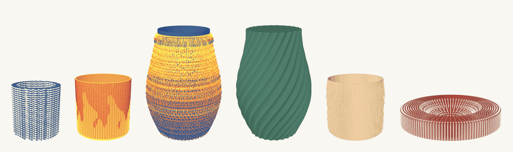</p>

<p align="center">
Woven baskets, knit and loop vases, halftone pictures, vase-mode twists, droop fringe and lithophanes.<br>
Pick a shape and a texture, and get a <b>print-ready Bambu Studio 3MF</b> with the AMS colours already mapped.
</p>

<p align="center">
  <a href="#quick-start"><b>Quick start</b></a> ·
  <a href="#textures"><b>All 43 textures</b></a> ·
  <a href="#use-it-as-a-claude-code-skill"><b>Claude Code skill</b></a> ·
  <a href="#faq"><b>FAQ</b></a>
</p>

## Quick start

```bash
git clone https://github.com/stilwellc/text2print && cd text2print
python3.12 -m venv .venv && .venv/bin/pip install -r requirements.txt
.venv/bin/python -m text2print studio        # opens the studio at http://127.0.0.1:7384
```

Pick a shape, texture, colours and nozzle; the preview rebuilds live. **Open in Bambu Studio** writes the
project to `~/Downloads/text2print/`. **Get exact print time** slices it with the Bambu Studio CLI, including
real AMS changes and purge. **Save design** keeps it under **Saved**, and every design is a shareable link.

<p align="center">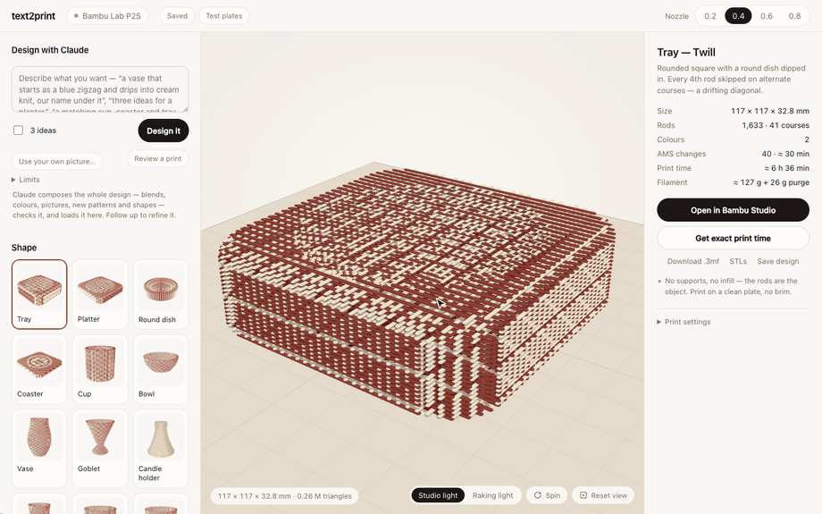</p>
<p align="center"><sub>The studio: pick a shape, a pattern and colours; the preview rebuilds live and the print card shows time, filament and AMS changes.</sub></p>

## Why text2print

Every texture is a **construction, not a surface effect**: woven rods stacked course by course, fabric whose
layers zigzag in mid-air, knit walls hung with thousands of single-strand loops. What you see in the preview is
what the printer lays down.

- **43 textures, 25 shapes,** from weaves and knits to halftone, CMYK, voronoi, lithophane and spiral vase mode.
- **Up to 4 colours, PLA or PETG.** Colours split into bands or stripes cut on layer boundaries, and every
  texture card shows its AMS change cost before you pick it.
- **Print-ready.** Bambu's own P2S presets are built in, no supports needed. Each project is one object with
  one part per AMS colour.
- **Lids.** Slip-on, a two-start screw (about one turn) or six 6 × 2 mm magnets, at a snug, slip or loose fit
  (0.15 / 0.25 / 0.40 mm a side; the *Fit* test plate prints all three). By default the lid wears the piece's
  own texture, with a knob, a button or neither.
- **Extendable by prompt.** Ask for "a koi pond halftone" or "a fish-scale knit" and Claude writes it as a plugin.

## How it works

<p align="center">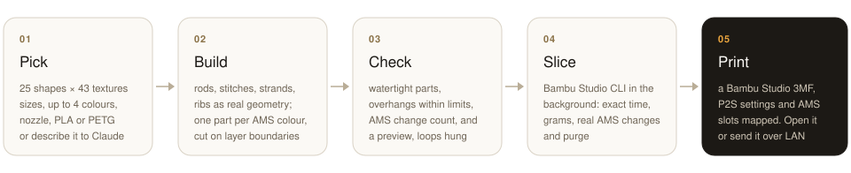</p>

<table>
  <tr>
    <td align="center" width="50%">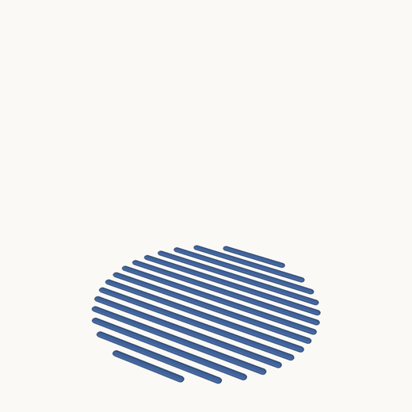<br><sub><b>Woven rods, course by course.</b> Each course is a row of rods that bridges the gaps in the one below it. Colour follows direction, so the AMS changes once per course.</sub></td>
    <td align="center" width="50%">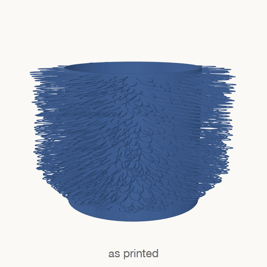<br><sub><b>Droop, as printed and after.</b> Strands are laid flat into the air, fast and hot, then sag into a hanging fringe as they cool. The preview shows both.</sub></td>
  </tr>
</table>

<p align="center"><sub>Every animation is the real build, rendered from the same geometry that goes into the Bambu Studio project by <a href="docs/make_media.py"><code>docs/make_media.py</code></a>, <a href="docs/make_motion.py"><code>make_motion.py</code></a> and <a href="docs/make_hero.py"><code>make_hero.py</code></a>.</sub></p>

## Command line

Everything the studio does is also a command. `./t2p` runs from any folder and prints JSON; a bad request exits 2
with an `error` that says what to fix.

```bash
./t2p list                                # shapes, sizes and the textures that fit each
./t2p options jacquard                    # every option a texture takes
./t2p make tray twill --colours "#8B3A2F,#EDE3D1" --out ~/Downloads/tray --preview --slice
./t2p make cup halftone --nozzle 0.8 --image flames.png --colours "#F3D34A,#C3302C" --out ~/Downloads/flames
./t2p make --design cup.json --save "Shag cup" --open     # a design file, studio link or saved name
./t2p ask "a low bowl that fades from brick to bone" --ideas 3      # Design with Claude
./t2p printer test                        # LAN check; `send DESIGN --confirm` slices and starts a print
```

A design is one JSON object:

```json
{"shape": "cup", "texture": "jacquard", "nozzle": 0.4, "params": {"diameter": 90, "height": 110},
 "colours": ["#151515", "#F4F2EC"], "options": {"loops": "shag", "band": 2}}
```

| `make` flag | |
|---|---|
| `--set key=mm`, `--option key=value`, `--colours`, `--nozzle` | sizes, options, colours, nozzle (JSON values work, e.g. `bands=[...]`) |
| `--draft` · `--preview` · `--slice` | quick sketch · PNG with loops hung · real time, grams and layers from Bambu Studio's CLI |
| `--save NAME` · `--open` · `--no-stls` · `--name STEM` | add to Saved · open in Bambu Studio · skip STLs · name the files |

`./t2p link`, `designs`, `taste` and `catalogue` cover links, the Saved list, taste notes and the full catalogue
as JSON (what an agent reads first).

### Parts that are not in the catalogue

A bracket, a sleeve, a stand, an STL you were handed: model the mesh however you like and let `part.deliver` write the
project with the right settings for the material, an STL per colour, a render, a dimensioned drawing and the slice.

```python
from text2print import part
r = part.deliver("pipe_sleeve", [("Sleeve", mesh, 1)], colours=["#FFFFFF"], material="petg", slice=True,
                 check={"length": (30.0, "z")})          # raises if the part is not the size you asked for
```

```bash
./t2p part bracket.stl --material petg --slice     # a ready-made STL as a project
./t2p check _slice/sliced.3mf                      # real first-layer and print speeds, changes, grams per filament
```

`lattice.weave_region` puts any woven pattern on your own outline (holes included) and `lattice.support_audit` checks
that no rod end is left in mid-air.

## Use it as a Claude Code skill

text2print ships as a [Claude Code](https://claude.com/claude-code) skill (`SKILL.md`):

```bash
ln -s "$PWD" ~/.claude/skills/text2print
```

> *"A low woven bowl that fades from brick to bone, our name under the base."*

Claude composes the design from the catalogue, builds it, checks the preview and hands you the Bambu project.
If nothing fits, it writes a new weave, stitch, picture or shape as a plugin first. In the studio, **Design with
Claude** does the same from a sentence or a photo, and *Make a new one* turns a description into a plugin in
about a minute.

## Textures

<table>
  <tr><td colspan="6"><b>Woven rods</b> · 17</td></tr>
  <tr>
    <td align="center" width="16%">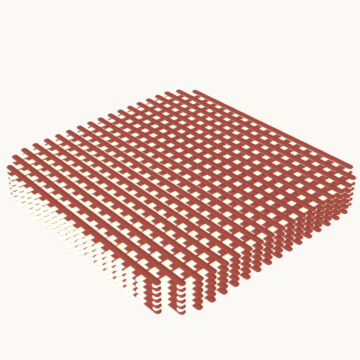<br><sub>Weave</sub></td>
    <td align="center" width="16%"><br><sub>Twill</sub></td>
    <td align="center" width="16%">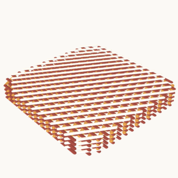<br><sub>Kagome</sub></td>
    <td align="center" width="16%">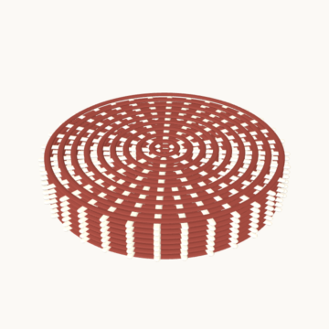<br><sub>Rose window</sub></td>
    <td align="center" width="16%">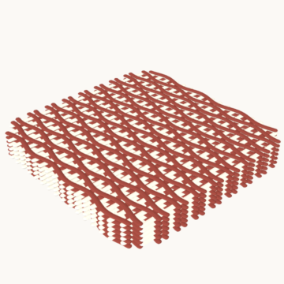<br><sub>Ripple</sub></td>
    <td align="center" width="16%">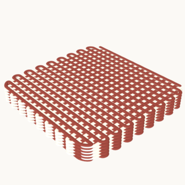<br><sub>Selvedge</sub></td>
  </tr>
  <tr>
    <td align="center" width="16%">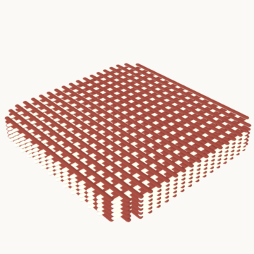<br><sub>Moiré</sub></td>
    <td align="center" width="16%">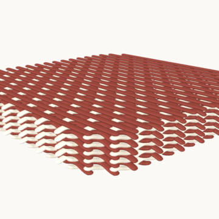<br><sub>Over-under</sub></td>
    <td align="center" width="16%">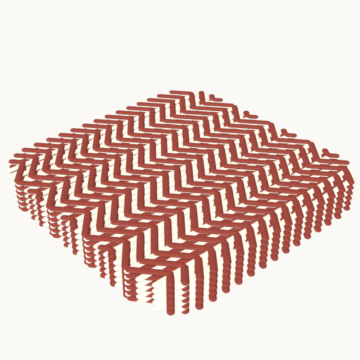<br><sub>Chevron</sub></td>
    <td align="center" width="16%">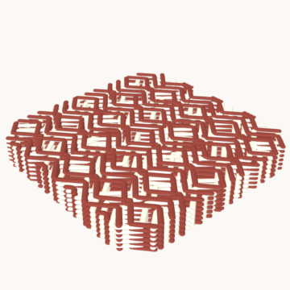<br><sub>Herringbone</sub></td>
    <td align="center" width="16%">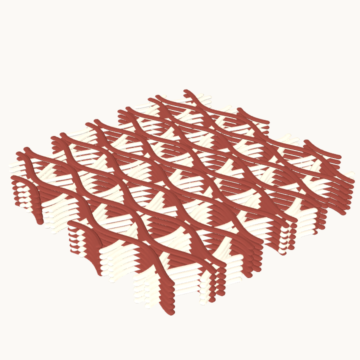<br><sub>Ogee</sub></td>
    <td align="center" width="16%">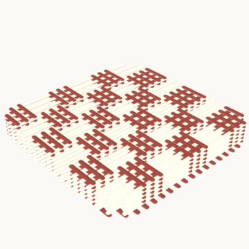<br><sub>Basketweave</sub></td>
  </tr>
  <tr>
    <td align="center" width="16%">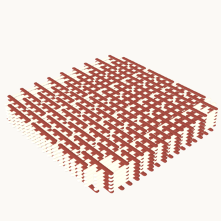<br><sub>Brick bond</sub></td>
    <td align="center" width="16%">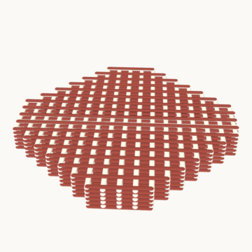<br><sub>Trellis</sub></td>
    <td align="center" width="16%">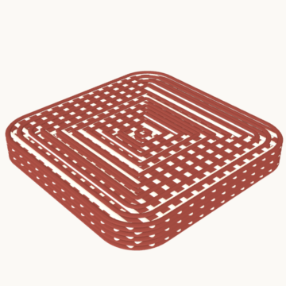<br><sub>Picture frame</sub></td>
    <td align="center" width="16%">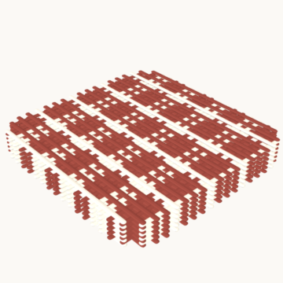<br><sub>Tartan</sub></td>
    <td align="center" width="16%">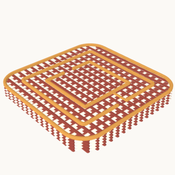<br><sub>Labyrinth</sub></td>
  </tr>
  <tr><td colspan="6"><b>Printed fabric and reliefs</b> · 6</td></tr>
  <tr>
    <td align="center" width="16%">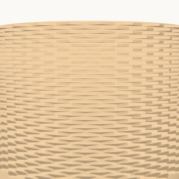<br><sub>Zigzag</sub></td>
    <td align="center" width="16%">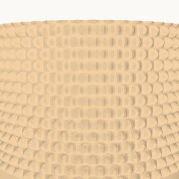<br><sub>Knit</sub></td>
    <td align="center" width="16%">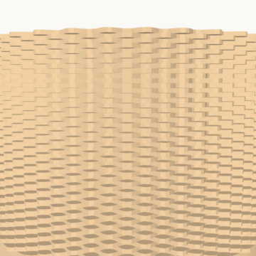<br><sub>Wave</sub></td>
    <td align="center" width="16%">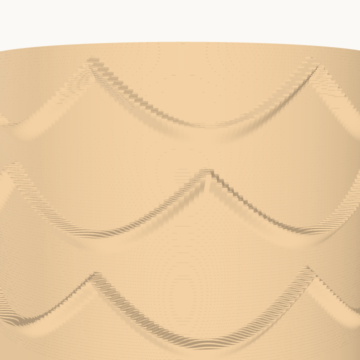<br><sub>Garland</sub></td>
    <td align="center" width="16%">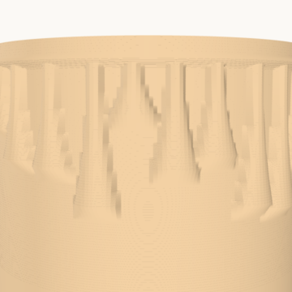<br><sub>Drips</sub></td>
    <td align="center" width="16%">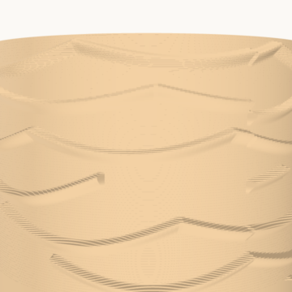<br><sub>Melt</sub></td>
  </tr>
  <tr><td colspan="6"><b>Droop and fur</b> · 5</td></tr>
  <tr>
    <td align="center" width="16%">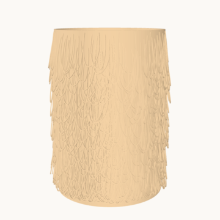<br><sub>Fringe</sub></td>
    <td align="center" width="16%">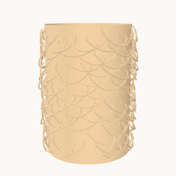<br><sub>Swag</sub></td>
    <td align="center" width="16%">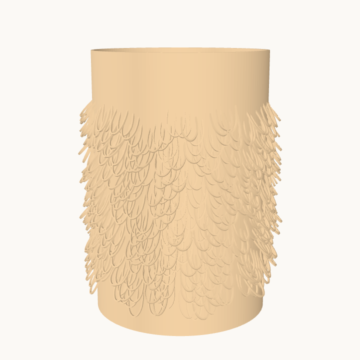<br><sub>Curls</sub></td>
    <td align="center" width="16%">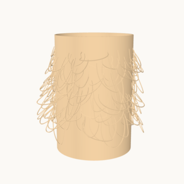<br><sub>Unraveled</sub></td>
    <td align="center" width="16%">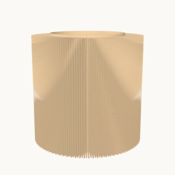<br><sub>Fur</sub></td>
  </tr>
  <tr><td colspan="6"><b>Colour pictures and knit</b> · 3</td></tr>
  <tr>
    <td align="center" width="16%">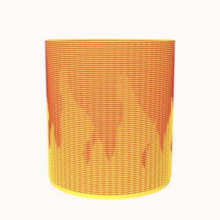<br><sub>Halftone</sub></td>
    <td align="center" width="16%">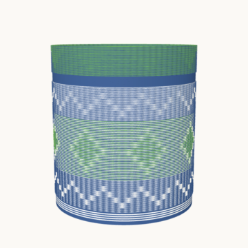<br><sub>Jacquard</sub></td>
    <td align="center" width="16%">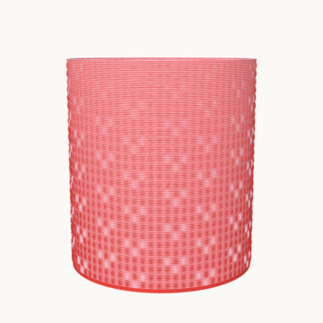<br><sub>Bead knit</sub></td>
  </tr>
  <tr><td colspan="6"><b>Vase mode</b> · 6</td></tr>
  <tr>
    <td align="center" width="16%">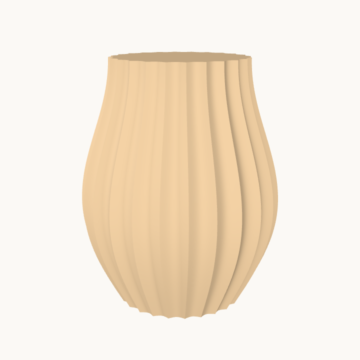<br><sub>Pleats</sub></td>
    <td align="center" width="16%">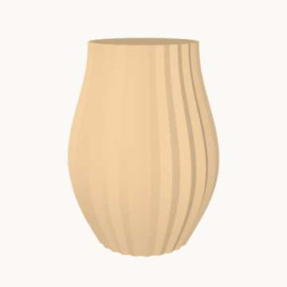<br><sub>Flutes</sub></td>
    <td align="center" width="16%">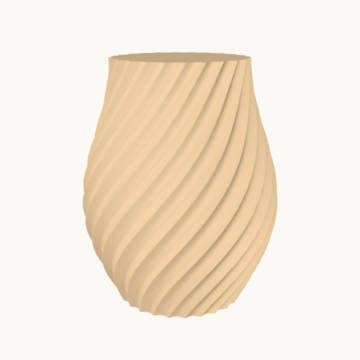<br><sub>Twist</sub></td>
    <td align="center" width="16%">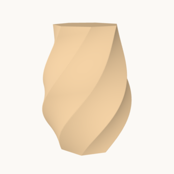<br><sub>Low-poly</sub></td>
    <td align="center" width="16%">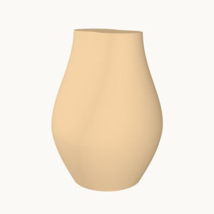<br><sub>Pinch</sub></td>
    <td align="center" width="16%">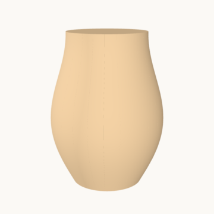<br><sub>Rib slits</sub></td>
  </tr>
  <tr><td colspan="6"><b>Shell</b> · 3</td></tr>
  <tr>
    <td align="center" width="16%">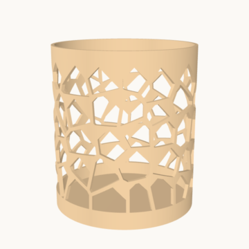<br><sub>Voronoi</sub></td>
    <td align="center" width="16%">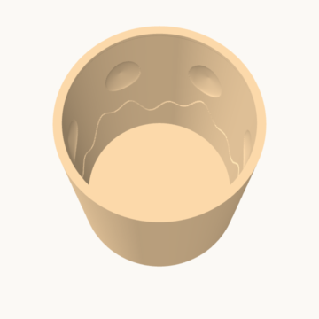<br><sub>Lithophane</sub></td>
    <td align="center" width="16%">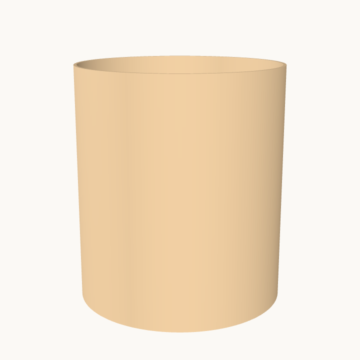<br><sub>Fuzzy skin</sub></td>
  </tr>
  <tr><td colspan="6"><b>Flat tiles</b> · 2</td></tr>
  <tr>
    <td align="center" width="16%">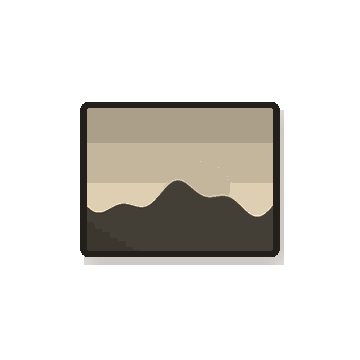<br><sub>Lithophane</sub></td>
    <td align="center" width="16%">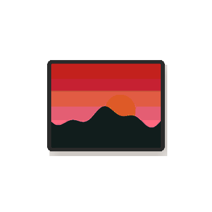<br><sub>Colour lithophane</sub></td>
  </tr>
  <tr><td colspan="6"><b>Mix</b> · 1</td></tr>
  <tr>
    <td align="center" width="16%">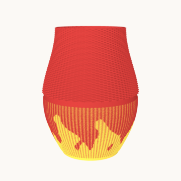<br><sub>Mix</sub></td>
  </tr>
</table>

<sub>Every card is rendered by the studio itself (`python -m text2print thumbs`).</sub>

**Woven rods.** Each course is a row of rounded beads; the next runs another way, so every rod bridges a short
gap. No supports, infill or walls: the rods are the object. Colour follows direction, so the AMS changes once
per course (Over-under and Tartan change about once per layer). Works on any round silhouette (bowl, vase,
goblet, amphora, sleeve) with no course stepping more than 0.8 mm per mm. A woven 180 mm vase slices at about
14 h 40 min and 260 g.

**Printed fabric and reliefs.** A two-loop wall whose layers alternate between mid-air stitches and straight
rings, with an optional looped rim and floor cut-outs. Reliefs (Garland, Drips, Melt) keep every underside at
45° or less.

**Droop and fur.** Strands leave the wall, arc into air and sag into hanging loops, laid fast and hot so they stay
molten. With 2–4 colours each row takes the next colour, so the AMS changes once per row. Fur bridges short stiff
hairs off the wall at full fan.

**Halftone.** Two colours alternate every layer, and the one that ribs outward paints the picture (built-ins, or
`--image photo.png`). It prints at the nozzle's maximum layer height with one wide line, after kowafatcompany's
[Fire Flame Vase](https://makerworld.com/en/models/3429731). The AMS changes every layer, so use a 0.8 nozzle,
2–3 layers per colour, a picture in the lower half, or one dual-colour silk spool (no changes at all).

**Colour-knit.** Jacquard and Bead knit work charts into the wall: fair-isle bands, motifs and pictures, in 2–3 colours.

**Vase mode.** One continuous spiral wall, no seams, fast: Pleats, Flutes, Twist, Low-poly, Pinch and Rib slits.
One colour; dual- or tri-colour silk shows the folds best.

**Shell and flat.** Voronoi cells cut through the wall with gable roofs, a lithophane that shows when lit from
inside, and Bambu's fuzzy skin in bands. Flat tiles print face-down: a one-colour lithophane, or CMYK over white
for full colour.

**Mix.** Stack textures in bands up one wall, each with its own height and colour, meeting in a fade, a dissolve,
or along a wave, zigzag, scallop, drip or torn edge. Woven bands sit on 45° collars. Presets include *Coil band*,
*Fringe skirt*, *Flame foot* and *Basket band*.

### Loops on colour-knit

<p align="center">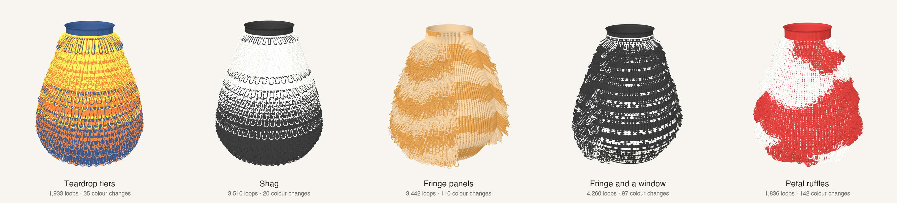</p>

A colour-knit wall already changes colour layer by layer. Hang a one-layer loop from it and the loop takes that
layer's colour, so thousands of loops cost no extra AMS changes. Pick a look under **Loops**:

| Look | What it is |
|---|---|
| Teardrop tiers | pinched teardrops in brick-offset rows, with long hairpins under the rim |
| Shag | short scallops in close rows |
| Fringe panels | two side panels of long hairpins; the knit shows front and back |
| Fringe and a window | fringe all round, leaving one arched knit window |
| Petal ruffles | scallops lengthening down overlapping petals, one colour each |

Loop colours fade *by row*, scatter as *salt*, or *follow the chart*. A looped piece can also carry inlaid words
under the base (`inlay_text=hello`). Loops are not yet print-verified, so print a small piece first.

### Pictures and plugins

Picture textures share one library: built-ins, your uploads, **text** in 11 fonts, and anything in
`~/.text2print/pictures`. New pictures, weaves, stitches and shapes are small Python plugins in
`~/.text2print/plugins`; `python -m text2print plugin check FILE` builds, checks and previews one
(examples in `plugin_examples/`). Words can also be debossed under the base or on a lid. Print time shows with
every build (fitted to 121 real P2S slices, typically within 10 %), and *Test plates* print small coupons of new
features before you commit to a big piece.

## Shapes

| Shape | `key` | Textures |
|---|---|---|
| Tray · Platter · Round dish · Cup · Bowl · Vase · Goblet · Amphora · Your shape · Paneled gourd · Paneled jar · Basket · Catch-all | `tray` `platter` `dish` `cup` `bowl` `vase` `goblet` `amphora` `custom` `gourd` `jar` `basket` `catchall` | woven, fabric, droop, halftone, colour-knit, vase mode, shell, mix |
| Cachepot · Glass sleeve | `cachepot` `sleeve` | woven, fabric, droop, halftone, colour-knit, vase mode, shell, mix; the inner size stays fitted to the pot or glass |
| Lidded box | `box` | woven, fabric, halftone, colour-knit, vase mode, shell, mix |
| Coaster · Hex tile | `coaster` `hextile` | woven, fabric, halftone, colour-knit, shell (hex tile: + photo) |
| Photo tile | `tile` | photo |
| Lamp shade | `shade` | woven |
| Tealight lantern · Pendant shade · LED puck lamp | `lantern` `pendant` `puck` | fabric, droop, halftone, colour-knit, vase mode, shell, mix |
| Candle holder | `candle` | droop |
| Mason jar lid | `jarlid` | fabric, halftone, colour-knit, shell; 86 mm wide-mouth or 70 mm regular, optional screw-capped pour spout |

Sizes and their ranges are in the studio and `./t2p list`. Square, rectangular and hex pieces take the wall
textures by mapping a round piece of the same circumference onto the outline. Lamps, lanterns, cachepots and
candles carry their hardware fit (collar, foot ring, crush ribs) and LED-only safety notes.

## Made for the Bambu Lab P2S

| Nozzle | Layer | Rod bead | Rod spacing | |
|---|---|---|---|---|
| 0.2 mm | 0.10 mm | 0.88 × 0.40 mm | 1.88 mm | computed |
| **0.4 mm** | **0.20 mm** | **1.68 × 0.80 mm** | **3.60 mm** | **print-verified** |
| 0.6 mm | 0.30 mm | 1.86 × 1.20 mm | 4.06 mm | computed |
| 0.8 mm | 0.40 mm | 2.46 × 1.60 mm | 5.26 mm | computed |

The profiles in `text2print/data/` are Bambu's own P2S presets with every `inherits` link resolved, so projects
don't depend on your Bambu Studio install. Each texture family then sets what it needs: rods bridge at full speed,
fabric prints as a 2-loop shell with no infill, droop strands print with a low fan and a hotter nozzle. PETG uses Bambu's
`Generic PETG @BBL P2S` preset per colour and its own process speeds (`printer.PETG_PROCESS`: walls 60/100 mm/s, bridges
30, first layer 20 with gentle moves); PLA keeps the stock ones. Loops and strands keep their own speeds on either material.
The shapes and textures were tuned on PLA Matte, and the app says so.

## What the slicer confirmed

<details><summary>Show</summary>

- Bambu Studio's CLI honours each part's AMS slot once every per-filament setting list is the right length, so
  the exact-time numbers include real colour changes. On three mixes the slicer's change count matched the app's
  estimate exactly.
- Layer ranges are keyed by the object's position in the build (`Metadata/layer_config_ranges.xml`). A range
  must set `layer_height`; line widths in a range drop layers of multi-part objects, and "extruder" breaks them.
- The prime tower needs every object on a plate to share one set of layer ranges.
- Weight comes back one number per filament; the app sums them.
- Spiral vase mode prints one wall and can't change filament.
- With three or more colours the prime tower grows deep: it parks front-right with 20 mm margins, or the G-code
  leaves the printable area.
- Purge per change comes from the colour pair (light after dark costs most), not a flat number.
- The headless CLI ignores `gap_fill_target`, `filter_out_gap_fill`, `infill_wall_overlap`, `detect_thin_wall`,
  `flush_multiplier` and a hand-written `flush_volumes_matrix` (it recomputes purge from the colour pair). Per-part
  `wall_loops` and `seam_position` are honoured. Run the CLI from the output folder with `--export-3mf <absolute path>`;
  `--outputdir` is not relied on.
- `ironing_type` "topmost" irons only the object's highest surface; an inlaid logo below a dome crown needs "top".
- Support is flagged from the vertical: an outward flare or a 45° chamfer at the base draws support; a straight
  first few mm draws none. Support grams come from NET E deltas (retract/de-retract cancel) over G1 AND G2/G3 arcs —
  Bambu arc-fits, so a round part is mostly arcs; a G1-only, positive-E-only sum is 3× low then 46 % high. Not
  toolpath length × filament area (≈9× too high). `bambu.support_grams` lands within 0.1 g of the declared weight.

- A loop must print as ONE bead. At the stock `min_bead_width` (85 %) Arachne traces each 1.0 mm loop as two thin
  lines with a zigzag at the round end; 150 % still split 3.5 % of them; 200 % gives one full-width strand out and
  back. Check it in the G-code: no loop length narrower than the strand.
- A modifier volume is honoured for line width and speed, but it cannot lower the fan for part of a layer, and
  temperature is per filament and per layer. Loop cooling is therefore a per-filament setting.
- Filament-preset keys (fan, temperatures) changed on top of a preset must be flagged per filament slot in
  `different_settings_to_system`, or Bambu Studio's window puts the preset's values back on open.
- A prime pad as a second object made Bambu Studio's window show the pad alone, though the CLI sliced both. The pad
  is now extra parts of the piece's own object.
- A piece that nearly fills the bed goes into the back-left corner with the tower hard in the front-right one;
  a 200 mm three-colour tray that used to fail with "G-code conflicts" slices that way. If they still meet, the
  build says so.
- "Front" is one angle everywhere (315°, the side the studio camera looks at): a front picture, a once-only motif
  and the bare window of the loop looks all face it.
- With the prime tower off, purge moves at the chute appear in the G-code as wall-type extrusions far from the
  piece; leave them out of any wall-continuity check.

</details>

## Laws

<details><summary>Show</summary>

These are print-verified, and the tests enforce the geometric ones.

- A woven object has a flat, full-size first course, and no course reaches past the one below it.
- A rod's skin stays inside the outline: bead centre lines are clipped half a bead in.
- Each colour is a part of one object, never its own object (alternating courses leave empty layers, which Bambu refuses).
- Fabric stitches keep their swing-to-wavelength ratio at every height, so narrow necks don't collapse.
- The layer height is part of the geometry: print at the nozzle's layer height.
- Droop strands are one extrusion wide, at most 4 layers tall, never touch each other in the mesh, and start high
  enough that the droop can't reach the bed. They print with overhang slow-down off, fan at 20 % and the nozzle
  5 °C hotter; slow or cold strands freeze where they are laid.
- Loops on colour-knit are one layer tall and one bead wide (0.8-1.0 mm), anchored in the wall at both ends, and never
  share a layer where they overlap: a loop whose layer is taken moves to the next layer that suits its colour. The
  wall is laid at 30 mm/s and loops at 40 with the fan at 20 %; layers shorter than 8 s are slowed, so a neck
  is not laid on a soft layer. PLA runs 5 °C hot so loops stay molten; PETG stays at its preset temperature.
- A colour plan is laid out against the piece's real height. (An oversize piece once had its chart computed for the
  picker's 220 mm limit and every feature near the top landed 30 mm low.)
- Fine 2-colour detail in PETG (a flat logo inlaid in a cap, verified Nov 2026 after three failed prints): rough,
  furry tops are a SPEED problem — top surface 25, outer wall 35, small perimeters 15, solid 60, minimum 30 s per
  layer — never ironing, never 0 walls (free line ends curl). Layer 0.12, top line width 0.3 (0.2 ropes); the
  horizontal-line look is the line width, not the layer height. A flat inlay top on an EVEN layer prints horizontal
  lines (Bambu alternates 0/90 each layer); a domed top prints rings. Round body: `seam_position` random, logo part
  back. The preset is `bambu.SHOWROOM_PETG_DETAIL` + `bambu.LOGO_PART`; `bambu.check_detail` proves it in the gcode.
- Measure, don't guess: recentre a raw CAD STL by its bounds midpoint before any radius; read 3D section vertices
  (`.to_2D()` reframes); build revolved parts from axis-Z cylinder frustums (`Manifold.revolve` mis-orients).
- Alternating colour bands: white = body ∩ (odd-band z-mask), black = body − mask — clean complements stay
  watertight. Each band is an AMS swap: purge and time scale with the count.

</details>

## FAQ

**Which printers does it support?** The bundled profiles are Bambu Lab's P2S presets for 0.2–0.8 mm nozzles.
Other printers can slice the STL/3MF parts, but the process settings are tuned for the P2S and its AMS.

**Do I need an AMS?** No. Every texture prints in one colour; the AMS is only for multicolour designs.

**Does it need supports?** No. Rods bridge short gaps, reliefs keep undersides at 45° or less, and Voronoi holes
are gable-roofed.

**What files does it make?** A Bambu Studio `.3mf` project (parts, colours, AMS slots, process settings), plus
STLs and a PNG preview on request.

**Can I add my own pattern or shape?** Yes, as a plugin in `~/.text2print/plugins` (see `plugin_examples/`), or
ask Claude to write one.

**What has actually been printed?** The woven twill tray and platter at 0.4 mm. Other nozzles and the loop looks
are computed and sliced but not yet printed.

## Repo

```
text2print/   build.py (pick -> project) · design.py (a design as data) · __main__.py (CLI) · agent.py
              shapes.py · lattice.py (woven) · fabric*.py · droop.py (strands, fur) · loops.py
              halftone.py · colourwork.py (knit charts) · compose.py (mix) · spiral.py (vase mode)
              shell.py (voronoi, litho, fuzzy) · flat.py (tiles) · extras.py (zones, lids)
              fittings.py · floors.py · meshops.py · verify.py · sampler.py (test plates)
              bambu.py (3MF + CLI slice) · printer.py + data/ (P2S) · lan.py · store.py
studio/       server.py + static/ (the picker)
docs/         make_media.py · make_motion.py · make_hero.py (the README animations)
t2p           the command line from any folder
tests/        python -m pytest (fast) · python -m pytest -m "" (everything, incl. the real slicer)
```

Adding a texture is one function in `lattice.py` (`PATTERNS`) or `fabric.py` (`STITCHES`); adding a shape is
one entry in `shapes.py`. Run `python -m text2print thumbs` to render its card.

## Contributing

Print results are the most useful contribution: open an issue with a photo, your nozzle, filament and the studio
link, and it moves a row above from *computed* to *print-verified*. New textures and shapes can start as plugins.
`python -m pytest` runs the fast suite; `python -m pytest -m ""` adds the real-slicer tests.

## License

[MIT](LICENSE). If text2print made something you like, a ⭐ helps other makers find it.
